.. RSeQC documentation master file, created by
   sphinx-quickstart on Thu Aug  9 21:50:37 2012.
   You can adapt this file completely to your liking, but it should at least
   contain the root `toctree` directive.

.. toctree::
   :maxdepth: 2

RSeQC
======

Comprehensive Quality Control for Bulk and Single-cell RNA Sequencing
---------------------------------------------------------------------

RSeQC (RNA-seq Quality Control) is a comprehensive Python package for quality
control of bulk and single-cell RNA sequencing (RNA-seq) data. It provides a
collection of command-line utilities for assessing sequencing quality, mapping
quality, library complexity, nucleotide composition bias, GC bias, read
distribution, transcript coverage, strand specificity, RNA integrity,
sequencing saturation, splice junction annotation, and many other metrics.

RSeQC supports modern Python environments (Python 3.9 or later) and can be
installed directly from `PyPI <https://pypi.org/project/RSeQC/>`_ or from the `GitHub source repository <https://github.com/liguowang/RSeQC>`_.

Release history
===================

**RSeQC v5.0.6**

* Oct. 19, 2026

* Continued Python 3 modernization and code cleanup across command-line scripts and ``qcmodule`` utilities.
* Centralized the package version in ``pyproject.toml`` and removed stale hard-coded module version numbers where appropriate.
* Improved ``src``-layout package discovery and packaging metadata for modern ``setuptools``/``pip`` builds.
* Added explicit ``pandas`` and ``matplotlib`` dependencies and aligned package metadata with GPL-3.0-or-later.
* Fixed and hardened several legacy utility modules, including FASTA/FASTQ, k-mer, ORF, quantile, WIG, statistics, and single-cell BAM helpers.
* Improved input validation, resource handling, error reporting, and Python 3 compatibility while preserving existing analysis behavior where possible.
* Fixed several single-cell BAM counting issues, including region-tag classification, UMI set initialization, gene counting, and zero-denominator reporting.
* Updated installation and project documentation for the v5.0.6 release.
* Fixed a bug in ``clipping_profile.py`` when analyzing variable-length reads.
  Soft-clipping counts were accumulated correctly across all read positions,
  but the output range in ``.clipping_profile.xls`` and
  ``.clipping_profile.r`` was determined by the length of the last alignment
  processed rather than the longest read. As a result, clipping counts at
  positions beyond the last read's length could be omitted from the output.
  The output range is now determined by the maximum read length observed,
  making clipping profiles independent of BAM read order.

**RSeQC v5.0.5**

* Jul. 26, 2026

* Modernized the entire RSeQC codebase while preserving existing analysis algorithms and output formats whenever possible.
* Replaced the legacy ``optparse`` interface with ``argparse`` across all command-line utilities.
* Improved command-line help messages, input validation, error reporting, and logging.
* Updated the Python packaging to support modern ``pip`` installation workflows via ``pyproject.toml``.
* Improved compatibility with recent Python (3.9+) and current versions of third-party dependencies.
* Modernized BigWig, BAM, FASTQ, and plotting utilities while maintaining backward compatibility.
* Added optional controls for skipping plot generation and specifying alternative ``Rscript`` executables where applicable.
* Improved robustness of single-cell RNA-seq utilities, including better validation and dependency checking.
* Updated documentation, GitHub repository, installation instructions, licensing information, and citation metadata.
* Published the project on GitHub and PyPI with automated continuous integration (GitHub Actions).

**RSeQC v5.0.4**

* Oct 3, 2024

Add :code:`pyproject.toml` file to manage project metadata. 

**RSeQC v5.0.1**

* Oct 20, 2022
* Fix a bug in :code:`scbam.py` to make it compatible with the latest `pysam <https://pysam.readthedocs.io/en/latest/index.html>`_ (v0.19.1).

**RSeQC v5.0.0**

* Oct 16, 2022
* add these functions to QC scRNA-seq data.
  * :code:`sc_bamStat.py`
  * :code:`sc_editMatrix.py`
  * :code:`sc_seqLogo.py`
  * :code:`sc_seqQual.py` 

**RSeQC v4.0.0**

* Aug. 21, 2020
* Add :code:`FPKM-UQ.py` to calcualte HTSeq count, FPKM and `FPKM-UQ <https://docs.gdc.cancer.gov/Data/Bioinformatics_Pipelines/Expression_mRNA_Pipeline/#upper-quartile-fpkm>`_ values defined by `TCGA <https://docs.gdc.cancer.gov/Data/Bioinformatics_Pipelines/Expression_mRNA_Pipeline/>`_
* :code:`FPKM-UQ.py` could exactly reproduce TCGA FPKM-UQ values, if you use TCGA BAM file (or follow TCGA RNA-seq alignment workflow to generate your own BAM file), the `GDC.h38 GENCODE v22 GTF <https://api.gdc.cancer.gov/data/25aa497c-e615-4cb7-8751-71f744f9691f>`_ file and the `GDC.h38 GENCODE TSV <https://api.gdc.cancer.gov/data/b011ee3e-14d8-4a97-aed4-e0b10f6bbe82>`_ file.

**RSeQC v3.0.1**

* Sep. 21, 2019
* Junctions detected from the :code:`junction_annotation.py` will be converted into `Interact <https://genome.ucsc.edu/goldenPath/help/interact.html>`_ format file, which can be uploaded into UCSC genome browser for visualization. Example:

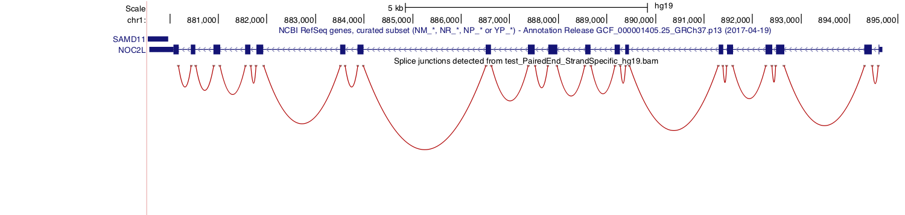

**RSeQC v3.0.0**

* **Support Python3**. Please use previous versions (v2.6.5 or older) if you are using Python2.
* add `pyBigWig <https://github.com/deeptools/pyBigWig>`_ as a dependency package.

**RSeQC v2.6.5, v2.6.6**

* Fix minor bugs. 

**RSeQC v2.6.4**

* Two dependency packages bx-python and pysam are **not** shipped with RSeQC starting from v2.6.4.
* Users could install RSeQC using pip: **pip install RSeQC**. bx-python and pysam will be installed automatically if they haven’t been installed before.

**RSeQC v2.6.3**

* Fix a bug in "read_quality.py" that does not return results if input file containing less than 1000 reads.
* Remove "RPKM_count.py" as it generates erroneous results especially for longer reads. Use "FPKM_count.py" instead.
* "bam_stat.py" prints summary statistics to STDOUT.

**RSeQC v2.6.2**

* fix bugs in "insertion_profile.py", "clipping_profile.py", and "inner_distance.py "

**RSeQC v2.6.1**

* Fix bug in "junction_annotation.py" in that it would report some "novel splice junctions" that don't exist in the BAM files. This happened when reads were clipped and spliced mapped simultaneously.
* Add FPKM.py. FPKM.py will report "raw fragment count", "FPM" and "FPKM" for each gene. It does not report exon and intron level count.

**RSeQC v2.6**

Add 3 new modules:

* deletion_profile.py
* insertion_profile.py
* mismatch_profile.py

**RSeQC v2.5**

* read_duplication.py:

 * add '-q' option filter alignments with low mapping quality.
 * Fix bug related to the labels of right Y-aixs

* bam2fq: add '-c' option to call 'gzip' command to compress output fastq file(s).
* divide_bam.py: add '-s' option, skipped unmapped reads.
* clipping_profile.py:

 * add '-q' option filter alignments with low mapping quality.
 * Issue warnning and exit if no clipped reads found.

**RSeQC v2.4**
rewrite "geneBody_coverage.py"

* Memory-efficient: consumed < 100M RAM

* Flexible input to handle one or more BAM files

::

 1. Input a singel BAM file. eg: **-i test.bam**
 2. Input several BAM files (separated by ","). eg: **-i test1.bam,test2.bam,test3.bam**
 3. Input plain text file containing the path of BAM file(s). eg: **-i bam_path.txt**
 4. Input a directory containing BAM file(s). eg: **-i my_folder**

* Generate heatmap to visualize gene body coverage over many samples.

**RSeQC v2.3.9**

* Add bam2fq.py. Transform BAM files into fastq format.
* bugs fixed.

**RSeQC v2.3.7**

* bam_stat.py: Now counts 'Proper-paired reads map to different chrom'
* bam2wig.py: automatically call 'wigToBigwig' if it can be found in system $PATH
* inner_distance.py: add 'PE_within_diff_chrom'

**RSeQC v2.3.3**

* Minor bugs fixed.

**RSeQC v2.3.2**

* Add split_bam.py: Split orignal BAM file into small BAM files based on provided gene list. User can use this module to estimate ribosome RNA amount if the input gene list is ribosomal RNA.
* Add  read_hexamer.py: Calculate hexamer frequency for multiple input files (fasta or fastq).
* Some parts were optimized and runs little faster.

RSeQC v2.3.1

* Add normalization option to bam2wig.py. With this option, user can normalize different sequencing depth into the same scale when converting BAM into wiggle format.
* Add another script. geneBody_coverage2.py. This script uses BigWig? instead of BAM as input, and requires much less memory (~ 200M)

Download
===============================

Download RSeQC
---------------

* `RSeQC (v5.0.6) <https://sourceforge.net/projects/rseqc/files/RSeQC-5.0.6.tar.gz/download>`_
* `RSeQC (v5.0.5) <https://sourceforge.net/projects/rseqc/files/rseqc-5.0.5.tar.gz/download>`_
* `RSeQC (v5.0.1) <https://sourceforge.net/projects/rseqc/files/RSeQC-5.0.1.tar.gz/download>`_
* `RSeQC (v5.0.0) <https://sourceforge.net/projects/rseqc/files/RSeQC-5.0.0.tar.gz/download>`_
* `RSeQC (v4.0.0) <https://sourceforge.net/projects/rseqc/files/RSeQC-4.0.0.tar.gz/download>`_
* `RSeQC (v3.0.1) <https://sourceforge.net/projects/rseqc/files/RSeQC-3.0.1.tar.gz/download>`_
* `RSeQC (v3.0.0) <https://sourceforge.net/projects/rseqc/files/RSeQC-3.0.0.tar.gz/download>`_
* `RSeQC (v2.6.6) <https://sourceforge.net/projects/rseqc/files/RSeQC-2.6.6.tar.gz/download>`_
* `RSeQC (v2.6.5) <https://sourceforge.net/projects/rseqc/files/RSeQC-2.6.5.tar.gz/download>`_
* `RSeQC (v2.6.4) <http://sourceforge.net/projects/rseqc/files/RSeQC-2.6.4.tar.gz/download>`_ 
* `RSeQC (v2.6.3) <http://sourceforge.net/projects/rseqc/files/RSeQC-2.6.3.tar.gz/download>`_
* `RSeQC (v2.6.2) <http://sourceforge.net/projects/rseqc/files/RSeQC-2.6.2.tar.gz/download>`_
* `RSeQC (v2.6.1) <http://sourceforge.net/projects/rseqc/files/RSeQC-2.6.1.tar.gz/download>`_
* `RSeQC (v2.6) <http://sourceforge.net/projects/rseqc/files/RSeQC-2.6.tar.gz/download>`_
* `RSeQC (v2.5) <http://sourceforge.net/projects/rseqc/files/RSeQC-2.5.tar.gz/download>`_
* `RSeQC (v2.4) <http://sourceforge.net/projects/rseqc/files/RSeQC-2.4.tar.gz/download>`_
* `RSeQC (v2.3.9) <http://sourceforge.net/projects/rseqc/files/RSeQC-2.3.9.tar.gz/download>`_
* `RSeQC (v2.3.8) <http://sourceforge.net/projects/rseqc/files/RSeQC-2.3.8.tar.gz/download>`_
* `RSeQC (v2.3.7) <https://sourceforge.net/projects/rseqc/files/RSeQC-2.3.7.tar.gz/download>`_
* `RSeQC (v2.3.6) <http://rseqc.googlecode.com/files/RSeQC-2.3.6.tar.gz>`_
* `RSeQC (v2.3.3) <http://rseqc.googlecode.com/files/RSeQC-2.3.3.tar.gz>`_
* `RSeQC (v2.3.2) <http://rseqc.googlecode.com/files/RSeQC-2.3.2.tar.gz>`_
* `RSeQC (v2.3.1) <http://rseqc.googlecode.com/files/RSeQC-2.3.1.tar.gz>`_

Download test datasets
--------------------------------

Pair-end strand specific (Illumina).

* `Pairend_StrandSpecific_51mer_Human_hg19.bam <https://data.cyverse.org/dav-anon/iplant/home/liguow/RSeQC/Pairend_StrandSpecific_51mer_Human_hg19.bam>`_
* md5sum=fbd1fb1c153e3d074524ec70e6e21fb9

Pair-end  non-strand specific (Illumina).

* `Pairend_nonStrandSpecific_36mer_Human_hg19.bam <https://data.cyverse.org/dav-anon/iplant/home/liguow/RSeQC/Pairend_nonStrandSpecific_36mer_Human_hg19.bam>`_
* md5sum=ba014f6b397b8a29c456b744237a12de

Single-end strand specific (SOLiD).

* `SingleEnd_StrandSpecific_50mer_Human_hg19.bam <https://data.cyverse.org/dav-anon/iplant/home/liguow/RSeQC/SingleEnd_StrandSpecific_50mer_Human_hg19.bam>`_
* md5sum=b39951a6ba4639ca51983c2f0bf5dfce

Single Cell RNA-seq data:

* BAM file generated by cellranger-7.0.1: `possorted_genome_bam.bam <https://sourceforge.net/projects/rseqc/files/scRNAseq_test/possorted_genome_bam.bam>`_
* md5sum=d0d8d4d58262091ad03386a35806d7dd

Download gene models (update on 12/14/2021)
--------------------------------------------

* `Human (hg38, hg19) <https://sourceforge.net/projects/rseqc/files/BED/Human_Homo_sapiens/>`_
* `Mouse (mm10,mm9) <https://sourceforge.net/projects/rseqc/files/BED/Mouse_Mus_musculus/>`_
* `Fly (dm3) <https://sourceforge.net/projects/rseqc/files/BED/fly_D.melanogaster/>`_
* `Zebrafish (danRer7) <https://sourceforge.net/projects/rseqc/files/BED/Zebrafish_Danio_rerio/>`_

.. NOTE::

  1) BED file for other species and the most recent release of these files can be downloaded from `UCSC Table Browser <https://genome.ucsc.edu/cgi-bin/hgTables?command=start>`_
  2) Make sure the gene model and the genome assembly are matched.

Download ribosome RNA (update on 07/08/2015)
---------------------------------------------
We only provide rRNA bed files for human and mouse. We download these ribosome RNAs from UCSC table browser,
we provide them here to facilitate users with NO WARRANTY in completeness.

* `GRCh38_rRNA.bed <http://sourceforge.net/projects/rseqc/files/BED/Human_Homo_sapiens/GRCh38_rRNA.bed.gz/download>`_
* `hg19_rRNA.bed <http://sourceforge.net/projects/rseqc/files/BED/Human_Homo_sapiens/hg19_rRNA.bed.gz/download>`_
* `mm10_rRNA.bed <http://sourceforge.net/projects/rseqc/files/BED/Mouse_Mus_musculus/mm10_rRNA.bed.gz/download>`_
* `mm9_rRNA.bed <http://sourceforge.net/projects/rseqc/files/BED/Mouse_Mus_musculus/mm9_rRNA.bed.gz/download>`_

Installation
============

Install the latest stable release from PyPI::

 pip install RSeQC

Or install the latest development version from GitHub::

 pip install git+https://github.com/liguowang/RSeQC.git

Use pip2 to install RSeQC (v2.6.6 or older)
--------------------------------------------

::

 pip2 install RSeQC

or you can simply use "pip install RSeQC" if your pip is a soft link to pip2 (use "pip show pip" to check)

Input format
============

RSeQC accepts 4 file formats as input:

* `BED <http://genome.ucsc.edu/FAQ/FAQformat.html#format1>`__ file is tab separated, 12-column, plain text file to represent gene model. Here is an `example <http://dldcc-web.brc.bcm.edu/lilab/liguow/RSeQC/dat/sample.bed>`_.
* `SAM <http://samtools.sourceforge.net/>`_ or `BAM <http://genome.ucsc.edu/goldenPath/help/bam.html>`__ files are used to store reads alignments. SAM file is human readable plain text file, while BAM is  binary version of SAM, a compact and index-able representation of reads alignments. Here is an `example <http://dldcc-web.brc.bcm.edu/lilab/liguow/RSeQC/dat/sample.sam>`__.
* Chromosome size file is a two-column, plain text file. Here is an `example <http://dldcc-web.brc.bcm.edu/lilab/liguow/RSeQC/dat/sample.hg19.chrom.sizes>`__ for human hg19 assembly. Use this `script <http://hgdownload.cse.ucsc.edu/admin/exe/linux.x86_64/fetchChromSizes>`__ to download chromosome size files of other genomes.
* `Fasta <http://en.wikipedia.org/wiki/FASTA_format>`__ file.

.. NOTE::

   If you have GFF/GTF format gene files, we found `bedopts <https://github.com/bedops/bedops>`__ might be useful to convert them to BED.

Fetch chromsome size file from UCSC
===================================

download this `script <http://sourceforge.net/projects/rseqc/files/other/fetchChromSizes/download>`__
and save as 'fetchChromSizes'::

 # Make sure it's executable
 chmod +x fetchChromSizes

 fetchChromSizes hg19 >hg19.chrom.sizes

 fetchChromSizes danRer7  >zebrafish.chrom.sizes

Usage Information
=================

bam2fq.py
----------
**Convert alignments in BAM or SAM format into fastq format.**

Options:
  --version             show program's version number and exit
  -h, --help            show this help message and exit
  -i INPUT_FILE, --input-file=INPUT_FILE
                        Alignment file in BAM or SAM format.
  -o OUTPUT_PREFIX, --out-prefix=OUTPUT_PREFIX
                        Prefix of output fastq files(s).
  -s, --single-end      Specificy '-s' or '--single-end' for single-end
                        sequencing.
  -c, --compress        Specificy '-c' or '--compress' to compress output
                        fastq file(s) using 'gzip' command.

Example::

 #pair-end
 $ python ../scripts/bam2fq.py -i test_PairedEnd_StrandSpecific_hg19.sam  -o bam2fq_out1
 Convert BAM/SAM file into fastq format ...  Done
 read_1 count: 649507
 read_2 count: 350495

 #single-end BAM file
 $ python ../scripts/bam2fq.py -i test_SingleEnd_StrandSpecific_hg19.bam -s -o bam2fq_out2
 Convert BAM/SAM file into fastq format ...  Done
 read count: 1000000

bam2wig.py
----------

**Convert BAM file into wig/bigWig format.**

1. bam2wig.py converts all types of RNA-seq data from `BAM <http://genome.ucsc.edu/goldenPath/help/bam.html>`__ format into `wiggle <http://genome.ucsc.edu/goldenPath/help/wiggle.html>`__ format.
2. If UCSC `wigToBigWig <http://hgdownload.cse.ucsc.edu/admin/exe/linux.x86_64/>`__ tool was found, output `wiggle <http://genome.ucsc.edu/goldenPath/help/wiggle.html>`__ file will be converted into `bigwig <http://genome.ucsc.edu/FAQ/FAQformat.html#format6.1>`__ format automatically.
3. `BAM <http://genome.ucsc.edu/goldenPath/help/bam.html>`__ file must be sorted and indexed properly using `SAMtools <http://samtools.sourceforge.net/samtools.shtml>`__. Below example shows how to sort and index BAM file using `samTools <http://samtools.sourceforge.net/samtools.shtml>`__

::

 # sort and index BAM files
 samtools sort -m 1000000000  input.bam input.sorted.bam
 samtools index input.sorted.bam

Options:
  --version             show program's version number and exit
  -h, --help            show this help message and exit
  -i INPUT_FILE, --input-file=INPUT_FILE
                        Alignment file in BAM format. BAM file must be sorted
                        and indexed using samTools. .bam and .bai files should
                        be placed in the same directory.
  -s CHROMSIZE, --chromSize=CHROMSIZE
                        Chromosome size file. Tab or space separated text file
                        with 2 columns: first column is chromosome name/ID,
                        second column is chromosome size. Chromosome names
                        (such as "chr1") should be consistent between this
                        file and the BAM file.
  -o OUTPUT_PREFIX, --out-prefix=OUTPUT_PREFIX
                        Prefix of output wiggle files(s). One wiggle file will
                        be generated for non strand-specific data, two wiggle
                        files ("Prefix_Forward.wig" and "Prefix_Reverse.wig")
                        will be generated for strand-specific RNA-seq data.
  -t TOTAL_WIGSUM, --wigsum=TOTAL_WIGSUM
                        Specified wigsum. Eg: 1,000,000,000 equals to coverage
                        of 10 million 100nt reads. Ignore this option to
                        disable normalization
  -u, --skip-multi-hits
                        Skip non-unique hit reads.
  -d STRAND_RULE, --strand=STRAND_RULE
                        How read(s) were stranded during sequencing. For
                        example: --strand='1++,1--,2+-,2-+' means that this is
                        a pair-end, strand-specific RNA-seq data, and the
                        strand rule is: read1 mapped to '+' => parental gene
                        on '+'; read1 mapped to '-' => parental gene on '-';
                        read2 mapped to '+' => parental gene on '-'; read2
                        mapped to '-' => parental gene on '+'.  If you are not
                        sure about the strand rule, run 'infer_experiment.py'
                        default=none (Not a strand specific RNA-seq data).
  -q MAP_QUAL, --mapq=MAP_QUAL
                        Minimum mapping quality for an alignment to be called
                        "uniquely mapped". default=30

Example::

 $ python2.7 bam2wig.py -s hg19.chrom.sizes -i sample.bam -o out -u

 Skip multi-hits:True
 No alignments for chr19_gl000208_random. skipped
 No alignments for chr21_gl000210_random. skipped
 No alignments for chr6_apd_hap1. skipped
 Processing chr13 ...
 Processing chr12 ...
 Processing chr11 ...
 Processing chr10 ...
 Processing chr17 ...
 Processing chr16 ...
 Processing chr15 ...
 Processing chr14 ...
 Processing chr19 ...
 Processing chr18 ...
 Processing chr8 ...
 Processing chr3 ...
 Processing chr1 ...
 Processing chrY ...
 Processing chrX ...
 Processing chr9 ...
 Processing chr22 ...
 Processing chr20 ...
 Processing chr21 ...
 Processing chr7 ...
 Processing chr6 ...
 Processing chr5 ...
 Processing chr4 ...
 Processing chr2 ...
 Run wigToBigWig out.wig /data2/bsi/staff_analysis/m102324/db_genome/genome/hg19.chrom.sizes out.bw

bam_stat.py
-----------

**Summarizing mapping statistics of a BAM or SAM file.**

This script determines "uniquely mapped reads" from `mapping quality <http://genome.sph.umich.edu/wiki/Mapping_Quality_Scores>`_, which quality the probability that a read is misplaced (Do NOT confused with sequence quality, sequence quality measures the probability that a base-calling was wrong) .

Options:
  --version             show program's version number and exit
  -h, --help            show this help message and exit
  -i INPUT_FILE, --input-file=INPUT_FILE
                        Alignment file in BAM or SAM format.
  -q MAP_QUAL, --mapq=MAP_QUAL
                        `Minimum mapping quality <http://genome.sph.umich.edu/wiki/Mapping_Quality_Scores>`_ to determine uniquely mapped read.

Example::

 bam_stat.py  -i Pairend_nonStrandSpecific_36mer_Human_hg19.bam

 #Output (all numbers are read count)
 #==================================================
 Total records:               		 	41465027
 QC failed:                   			0
 Optical/PCR duplicate:       			0
 Non Primary Hits             			8720455
 Unmapped reads:               			0

 mapq < mapq_cut (non-unique): 			3127757
 mapq >= mapq_cut (unique):   			29616815
 Read-1:                       			14841738
 Read-2:                       			14775077
 Reads map to '+':             			14805391
 Reads map to '-':            		 	14811424
 Non-splice reads:            		 	25455360
 Splice reads:                 			4161455
 Reads mapped in proper pairs: 			21856264
 Proper-paired reads map to different chrom:	7648

clipping_profile.py
-------------------
**Calculate the distributions of clipped nucleotides across reads**

This program is used to estimate clipping profile of RNA-seq reads from BAM or SAM file.
Note that to use this funciton, CIGAR strings within SAM/BAM file should have 'S' operation
(This means your reads aligner should support clipped mapping).

Options:
  --version             show program's version number and exit
  -h, --help            show this help message and exit
  -i INPUT_FILE, --input-file=INPUT_FILE
                        Alignment file in BAM or SAM format.
  -o OUTPUT_PREFIX, --out-prefix=OUTPUT_PREFIX
                        Prefix of output files(s).
  -q MAP_QUAL, --mapq=MAP_QUAL
                        Minimum mapping quality (phred scaled) for an
                        alignment to be considered as "uniquely mapped".
                        default=30
  -s LAYOUT, --sequencing=LAYOUT
                        Sequencing layout. "SE"(single-end) or "PE"(pair-end).

Example::

 $ clipping_profile.py -i Pairend_StrandSpecific_51mer_Human_hg19.bam -s "PE" -o out

 $ ls -l out.clipping_profile.* |awk '{print $9}'
 out.clipping_profile.r
 out.clipping_profile.R1.pdf
 out.clipping_profile.R2.pdf
 out.clipping_profile.xls

NOTE:
 * Only 1 PDF file will be generated if -s "SE" was specified.
 * "out.clipping_profile.r" is the R script file used to generate pdf file(s).
 * "out.clipping_profile.xls" contains 3 columns: the first column is position (starting from 0) of read  in 5'->3' direction; the second column is the number of reads clipped at this position; the third column is the number of reads non-clipped at this position.

Read-1 clipping profile:

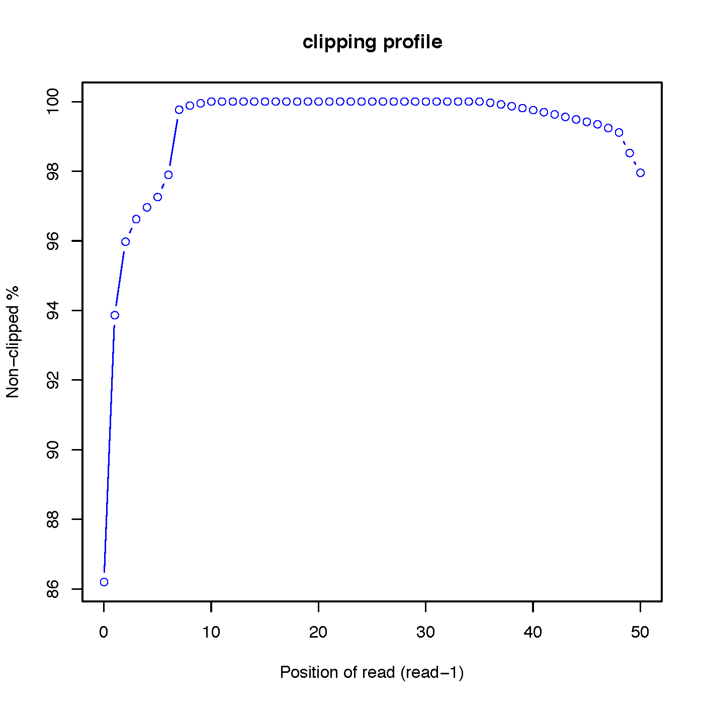

Read-2 clipping profile:

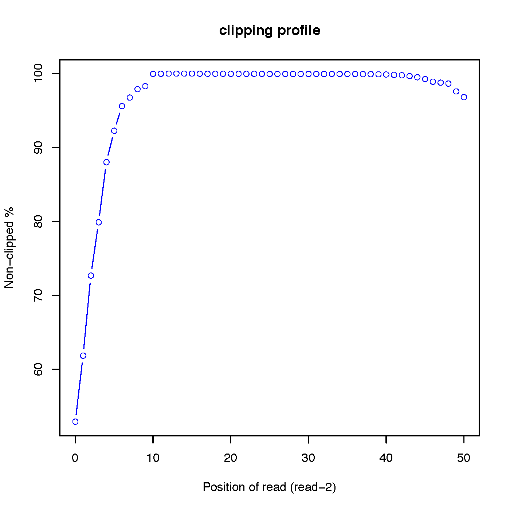

deletion_profile.py
-------------------
**Calculate the distributions of deletions across reads**

Options:
  --version             show program's version number and exit
  -h, --help            show this help message and exit
  -i INPUT_BAM, --input=INPUT_BAM
                        Input BAM file. [required]
  -l READ_ALIGNMENT_LENGTH, --read-align-length=READ_ALIGNMENT_LENGTH
                        Alignment length of read. It is usually set to the
                        orignial read length. For example, all these cigar
                        strings ("101M", "68M140N33M", "53M1D48M") suggest the
                        read alignment length is 101. [required]
  -o OUTPUT_PREFIX, --out-prefix=OUTPUT_PREFIX
                        Prefix of output files(s). [required]
  -n READ_NUMBER, --read-num=READ_NUMBER
                        Number of aligned reads with mismatches used to
                        calculate the mismatch profile. default=1000000
  -q MAP_QUAL, --mapq=MAP_QUAL
                        Minimum mapping quality. default=30

Example::

 $ python2.7  deletion_profile.py -i sample.bam -l 101 -o out
 Process BAM file ...  Total reads used: 58310

 $ ls -l out.deletion_profile.* |awk '{print $9}'
 out.deletion_profile.pdf
 out.deletion_profile.r
 out.deletion_profile.txt

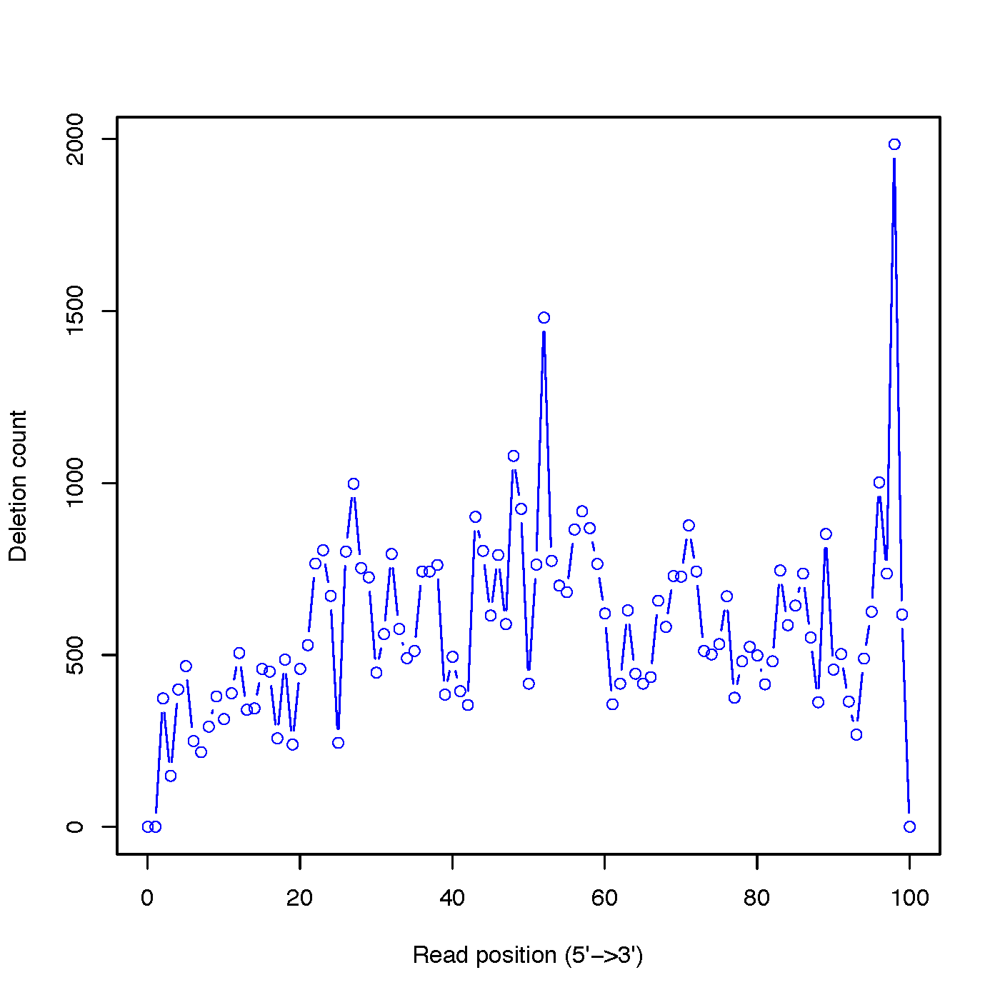

divide_bam.py
-------------
**Equally divide BAM file (m alignments) into n parts. Each part contains roughly m/n alignments that are randomly sampled from total alignments.**

Options:
  --version             show program's version number and exit
  -h, --help            show this help message and exit
  -i INPUT_FILE, --input-file=INPUT_FILE
                        Alignment file in BAM format. BAM file should be
                        sorted and indexed.
  -n SUBSET_NUM, --subset-num=SUBSET_NUM
                        Number of small BAM files
  -o OUTPUT_PREFIX, --out-prefix=OUTPUT_PREFIX
                        Prefix of output BAM files. Output "Prefix_num.bam".
  -s, --skip-unmap      Skip unmapped reads.

Example::

 python2.7 divide_bam.py -n 3 -i SingleEnd_StrandSpecific_50mer_Human_hg19.bam -o output
 Dividing SingleEnd_StrandSpecific_50mer_Human_hg19.bam ... Done
 output_0.bam                                           22179548
 output_1.bam                                           22185659
 output_2.bam                                           22187574

FPKM_count.py
-------------
**Calculate raw read count, FPM (fragment per million) and FPKM (fragment per million mapped reads per kilobase exon) for each gene in BED file.**
Note: SAM file is not supported.

Options:
  --version             show program's version number and exit
  -h, --help            show this help message and exit
  -i INPUT_FILE, --input-file=INPUT_FILE
                        Alignment file in BAM format (SAM is not supported).
                        [required]
  -o OUTPUT_PREFIX, --out-prefix=OUTPUT_PREFIX
                        Prefix of output files(s). [required]
  -r REFGENE_BED, --refgene=REFGENE_BED
                        Reference gene model in bed fomat. [required]
  -d STRAND_RULE, --strand=STRAND_RULE
                        How read(s) were stranded during sequencing. For
                        example: --strand='1++,1--,2+-,2-+' means that this is
                        a pair-end, strand-specific RNA-seq, and the strand
                        rule is: read1 mapped to '+' => parental gene on '+';
                        read1 mapped to '-' => parental gene on '-'; read2
                        mapped to '+' => parental gene on '-'; read2 mapped to
                        '-' => parental gene on '+'.  If you are not sure
                        about the strand rule, run 'infer_experiment.py'
                        default=none (Not a strand specific RNA-seq data)
  -u, --skip-multi-hits
                        How to deal with multiple hit reads. Presence this
                        option renders program to skip multiple hits reads.
  -e, --only-exonic     How to count total reads. Presence of this option
                        renders program only used exonic (UTR exons and CDS
                        exons) reads, otherwise use all reads.
  -q MAP_QUAL, --mapq=MAP_QUAL
                        Minimum mapping quality (phred scaled) for an
                        alignment to be called "uniquely mapped". default=30
  -s SINGLE_READ, --single-read=SINGLE_READ
                        How to count read-pairs that only have one end mapped.
                        0: ignore it. 0.5: treat it as half fragment. 1: treat
                        it as whole fragment. default=1

Output:

======  =========       ==========      ==========      =========       ============    ===========     =============   =============
#chrom  st              end             accession       mRNA_size       gene_strand     Frag_count      FPM             FPKM
======  =========       ==========      ==========      =========       ============    ===========     =============   =============
chr1    100652477       100715409       NM_001918       10815.0         '-'              5498.0          191.73788949    17.728884835
chr1    175913961       176176380       NM_022457       2789.0          '-'              923.0           32.188809021    11.541344217
chr1    150980972       151008189       NM_021222       2977.0          '+'              687.0           23.958517657    8.0478729115
chr1    6281252         6296044         NM_012405       4815.0          '-'              1396.0          48.684265866    10.11095864
chr1    20959947        20978004        NM_032409       2660.0          '+'              509.0           17.750925018    6.6732800821
chr1    32479294        32509482        NM_006559       2891.0          '+'              2151.0          75.014223408    25.947500314
======  =========       ==========      ==========      =========       ============    ===========     =============   =============

FPKM-UQ.py
----------

Calculate count, FPKM, and FPKM-UQ values defined by `TCGA <https://docs.gdc.cancer.gov/Data/Bioinformatics_Pipelines/Expression_mRNA_Pipeline/#upper-quartile-fpkm>`_

.. Note::

   This program generates *exactly* the same FPKM and FPKM-UQ values as TCGA, if:

   1) you use the TCGA BAM file, or follow the `TCGA RNA-seq workflow <https://docs.gdc.cancer.gov/Data/Bioinformatics_Pipelines/Expression_mRNA_Pipeline/#rna-seq-alignment-workflow>`_ to generate your own BAM file.

   2) use the `GENCODE v22 GTF file <https://api.gdc.cancer.gov/data/25aa497c-e615-4cb7-8751-71f744f9691f>`_.

   3) use the `GENCODE v22 information file <https://api.gdc.cancer.gov/data/b011ee3e-14d8-4a97-aed4-e0b10f6bbe82>`_.

   4) you must install `HTSeq <https://pypi.org/project/HTSeq/>`_. And the 'htseq-count' command is callable.

Options:
  --version             show program's version number and exit
  -h, --help            show this help message and exit
  --bam=BAM_FILE        Alignment file in BAM format. BAM file shoul be sorted
                        and indexed. Ideally, the BAM file should generaet
                        from the TCGA RNA-seq analysis workflow described `here
                        <https://docs.gdc.cancer.gov/Data/Bioinformatics_Pipeli
                        nes/Expression_mRNA_Pipeline/>`_.
  --gtf=GTF_FILE        Gene model in GTF format.
  --info=INFOR_FILE     Gene model information file.
  -o OUT_FILE, --output=OUT_FILE
                        The prefix of the output file.
  --log2                Convert FPKM and FPKM-UQ values into log2 (x+1) scale.
                        A pseudo count 1 will be added to each
                        gene/transcript.

Example (analyze kidney cancer BAM file, TCGA barcode is : "TCGA-B0-4821")::

 FPKM-UQ.py --bam 8e5c811c-132a-4f27-b7ef-1a4a644f9079_gdc_realn_rehead.bam --gtf gencode.v22.annotation.gtf --info gencode.gene.info.v22.tsv -o output

geneBody_coverage.py
--------------------------------
**Calculate the RNA-seq reads coverage over gene body.**

Ihis workflow is illustrated below:

1. If 3 or more BAM files were provided. This program generated a lineGraph and a heatmap.
   If less than 3 BAM files were provided, only lineGraph was generated. See below for examples.
2. When heatmap was generated, samples were ranked by the "skewness" of the coverage:
   Sample with best (worst) coverage will be displayed at the top (bottom) of the heatmap.
3. Coverage skewness was measured by `Pearson's skewness coefficients <http://en.wikipedia.org/wiki/Skewness#Pearson.27s_skewness_coefficients>`_

NOTE:

 * Only input **sorted** and **indexed** BAM file(s).
 * Genes/transcripts with mRNA length < 100 will be skipped (Number specified to "-l" cannot be < 100).

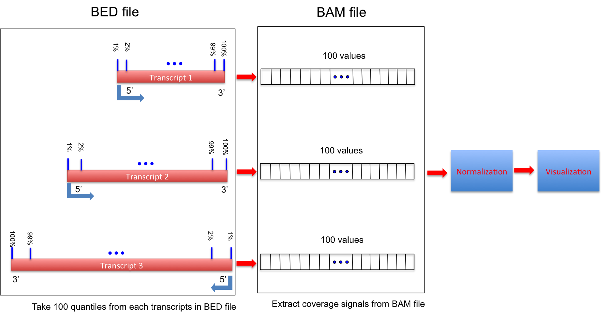

Options:
  --version             show program's version number and exit
  -h, --help            show this help message and exit
  -i INPUT_FILES, --input=INPUT_FILES
                        Input file(s) in BAM format. "-i" takes these input:
                        1) a single BAM file. 2) "," separated BAM files. 3)
                        directory containing one or more bam files. 4) plain
                        text file containing the path of one or more bam file
                        (Each row is a BAM file path). All BAM files should be
                        sorted and indexed using samtools.
  -r REF_GENE_MODEL, --refgene=REF_GENE_MODEL
                        Reference gene model in bed format. [required]
  -l MIN_MRNA_LENGTH, --minimum_length=MIN_MRNA_LENGTH
                        Minimum mRNA length (bp). mRNA smaller than
                        "min_mRNA_length" will be skipped. default=100
  -f OUTPUT_FORMAT, --format=OUTPUT_FORMAT
                        Output file format, 'pdf', 'png' or 'jpeg'.
                        default=pdf
  -o OUTPUT_PREFIX, --out-prefix=OUTPUT_PREFIX
                        Prefix of output files(s). [required]

Example:

1. A single BAM file.

::

 $ geneBody_coverage.py -r hg19.housekeeping.bed -i test.bam  -o output

2. A list of BAM files separated by ",".
::

$ geneBody_coverage.py -r hg19.housekeeping.bed -i test1.bam,test2.bam,test3.bam  -o output

3. Plain text file containing the paths of BAM files.
::

 $ geneBody_coverage.py -r hg19.housekeeping.bed -i bam_path.txt  -o output
 $ cat  bam_path.txt
 /data/alignment/test1.bam
 /data/alignment/test2.bam
 /data/alignment/test3.bam

4. A directory containing BAM files.
::

 $ geneBody_coverage.py -r hg19.housekeeping.bed -i /data/alignment/  -o output

Output:

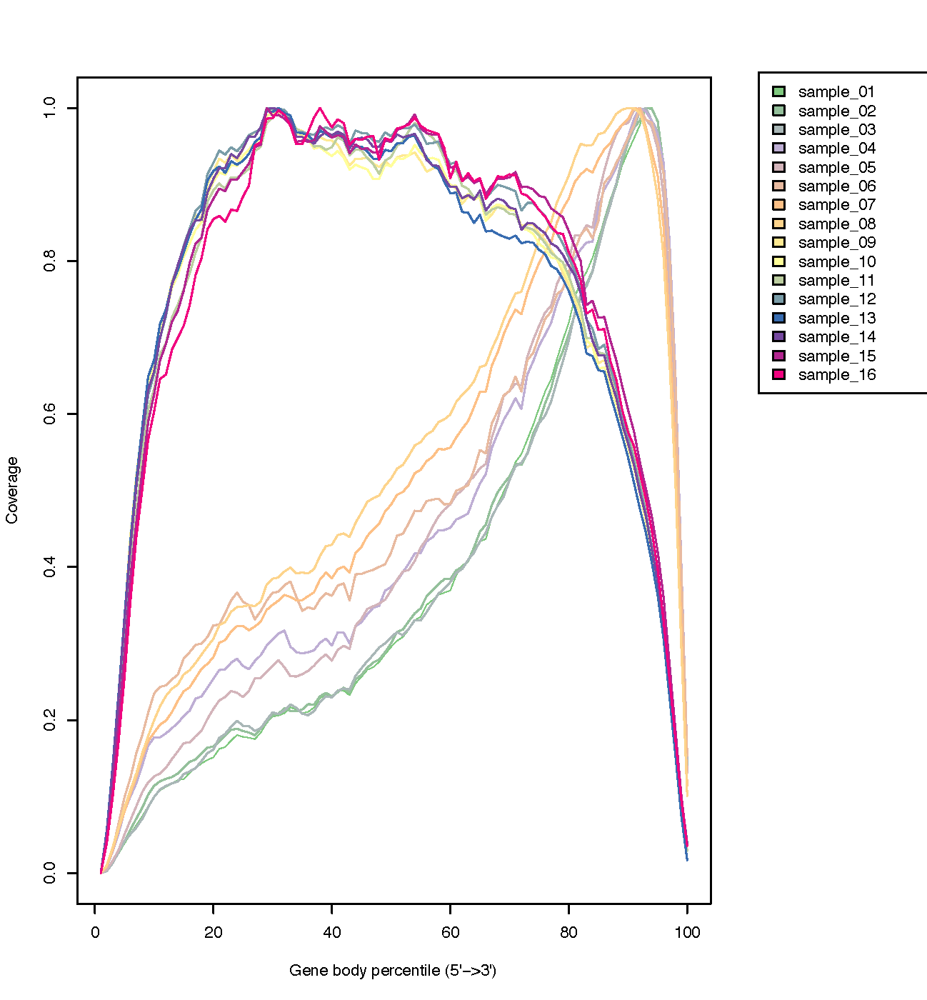
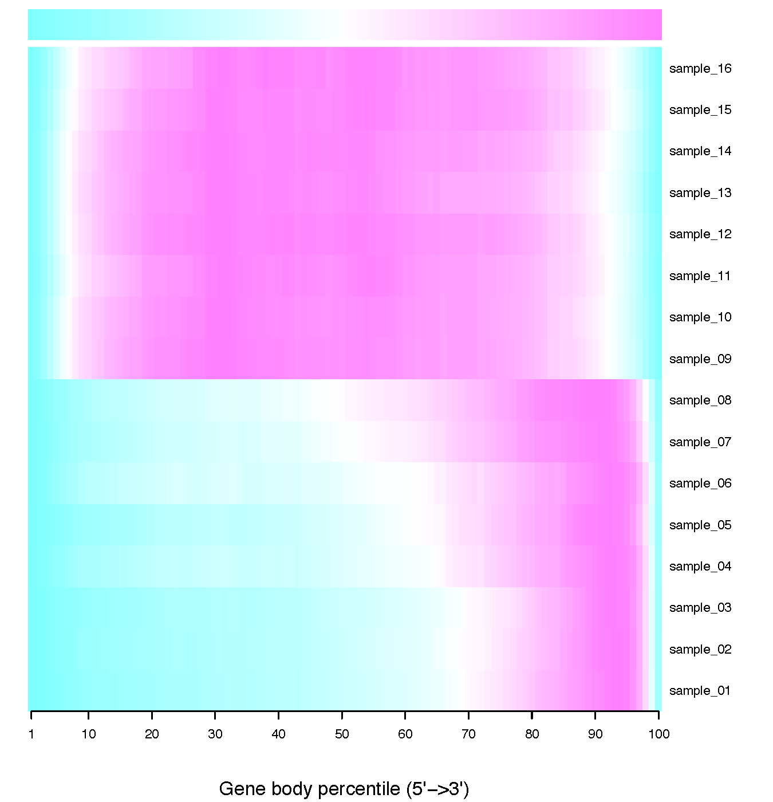

geneBody_coverage2.py
--------------------------------
**Calculate the RNA-seq reads coverage over gene body. This module uses bigwig file as input.**

Options:
  --version             show program's version number and exit
  -h, --help            show this help message and exit
  -i INPUT_FILE, --input-file=INPUT_FILE
                        Coverage signal file in bigwig format
  -r REF_GENE_MODEL, --refgene=REF_GENE_MODEL
                        Reference gene model in bed format. [required]
  -o OUTPUT_PREFIX, --out-prefix=OUTPUT_PREFIX
                        Prefix of output files(s). [required]
  -t GRAPH_TYPE, --graph-type=GRAPH_TYPE
                        Graphic file type in "pdf", "jpeg", "bmp", "bmp",
                        "tiff" or "png".default=png [optional]

infer_experiment.py
---------------------------------
1. This program is used to "guess" how RNA-seq sequencing were configured, particulary how reads were stranded for strand-specific RNA-seq data, through comparing the "strandness of reads" with the "standness of transcripts".
2. The "strandness of reads" is determiend from alignment, and the "standness of transcripts" is determined from annotation.
3. For non strand-specific RNA-seq data, "strandness of reads" and "standness of transcripts" are **independent**.
4. For strand-specific RNA-seq data, "strandness of reads" is largely determined by "standness of transcripts". See below 3 examples for details.
5. You don't need to know the RNA sequencing protocol before mapping your reads to the reference genome. Mapping your RNA-seq reads as if they were non-strand specific, this script can "guess" how RNA-seq reads were stranded.

For pair-end RNA-seq, there are two different ways to strand reads (such as Illumina ScriptSeq protocol):

1. 1++,1--,2+-,2-+

* read1 mapped to '+' strand indicates parental gene on '+' strand
* read1 mapped to '-' strand indicates parental gene on '-' strand
* read2 mapped to '+' strand indicates parental gene on '-' strand
* read2 mapped to '-' strand indicates parental gene on '+' strand

2. 1+-,1-+,2++,2--

* read1 mapped to '+' strand indicates parental gene on '-' strand
* read1 mapped to '-' strand indicates parental gene on '+' strand
* read2 mapped to '+' strand indicates parental gene on '+' strand
* read2 mapped to '-' strand indicates parental gene on '-' strand

For single-end RNA-seq, there are also two different ways to strand reads:

1. ++,--

* read mapped to '+' strand indicates parental gene on '+' strand
* read mapped to '-' strand indicates parental gene on '-' strand

2. +-,-+

* read mapped to '+' strand indicates parental gene on '-' strand
* read mapped to '-' strand indicates parental gene on '+' strand

Options:
  --version             show program's version number and exit
  -h, --help            show this help message and exit
  -i INPUT_FILE, --input-file=INPUT_FILE
                        Input alignment file in SAM or BAM format
  -r REFGENE_BED, --refgene=REFGENE_BED
                        Reference gene model in bed fomat.
  -s SAMPLE_SIZE, --sample-size=SAMPLE_SIZE
                        Number of reads sampled from SAM/BAM file.
                        default=200000
  -q MAP_QUAL, --mapq=MAP_QUAL
                        Minimum mapping quality (phred scaled) for an
                        alignment to be considered as "uniquely mapped".
                        default=30

**Example 1: Pair-end non strand specific**::

 infer_experiment.py -r hg19.refseq.bed12 -i Pairend_nonStrandSpecific_36mer_Human_hg19.bam

 #Output::

 This is PairEnd Data
 Fraction of reads failed to determine: 0.0172
 Fraction of reads explained by "1++,1--,2+-,2-+": 0.4903
 Fraction of reads explained by "1+-,1-+,2++,2--": 0.4925

**Interpretation**:
1.72% of total reads were mapped to genome regions that we cannot determine the "standness of transcripts" (such as regions that having both strands transcribed).
For the remaining 98.28% (1 - 0.0172 = 0.9828) of reads, half can be explained by "1++,1--,2+-,2-+", while the other half can be explained by "1+-,1-+,2++,2--".
We conclude that this is **NOT a strand specific dataset** because "strandness of reads" was independent of "standness of transcripts"

**Example 2: Pair-end strand specific**::

 infer_experiment.py -r hg19.refseq.bed12 -i Pairend_StrandSpecific_51mer_Human_hg19.bam

 #Output::

 This is PairEnd Data
 Fraction of reads failed to determine: 0.0072
 Fraction of reads explained by "1++,1--,2+-,2-+": 0.9441
 Fraction of reads explained by "1+-,1-+,2++,2--": 0.0487

**Interpretation**:
0.72% of total reads were mapped to genome regions that we cannot determine the "standness of transcripts" (such as regions that having both strands transcribed).
For the remaining 99.28% (1 - 0.0072 = 0.9928) of reads, the vast majority was explained by "1++,1--,2+-,2-+", suggesting a strand-specific dataset.

**Example 3: Single-end strand specific**::

 infer_experiment.py -r hg19.refseq.bed12 -i SingleEnd_StrandSpecific_36mer_Human_hg19.bam

 #Output::

 This is SingleEnd Data
 Fraction of reads failed to determine: 0.0170
 Fraction of reads explained by "++,--": 0.9669
 Fraction of reads explained by "+-,-+": 0.0161

**Interpretation**:
This is single-end, strand specific RNA-seq data. Strandness of reads are concordant with strandness of reference gene.

inner_distance.py
--------------------------

**Calculate inner distance between read pairs.**

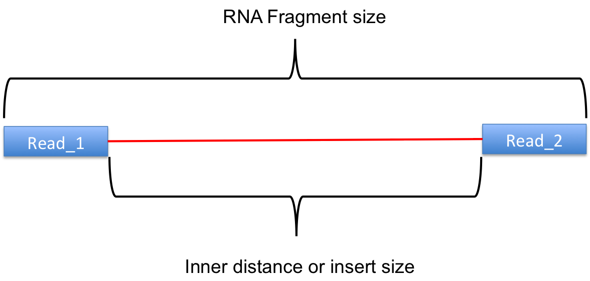

This module is used to calculate the inner distance (or insert size) between two paired RNA
reads. The distance is the mRNA length between two paired fragments. We first determine the
genomic (DNA) size between two paired reads: D_size = read2_start - read1_end, then

* if two paired reads map to the same exon: inner distance = D_size
* if two paired reads map to different exons:inner distance = D_size - intron_size
* if two paired reads map non-exonic region (such as intron and intergenic region): inner distance = D_size
* The inner_distance might be a negative value if two fragments were overlapped.

NOTE: Not all read pairs were used to estimate the inner distance distribution. Those low
quality, PCR duplication, multiple mapped reads were skipped.

Options:
  --version             show program's version number and exit
  -h, --help            show this help message and exit
  -i INPUT_FILE, --input-file=INPUT_FILE
                        Alignment file in BAM or SAM format.
  -o OUTPUT_PREFIX, --out-prefix=OUTPUT_PREFIX
                        Prefix of output files(s)
  -r REF_GENE, --refgene=REF_GENE
                        Reference gene model in BED format.
  -k SAMPLESIZE, --sample-size=SAMPLESIZE
                        Number of read-pairs used to estimate inner distance.
                        default=1000000
  -l LOWER_BOUND_SIZE, --lower-bound=LOWER_BOUND_SIZE
                        Lower bound of inner distance (bp). This option is
                        used for ploting histograme. default=-250
  -u UPPER_BOUND_SIZE, --upper-bound=UPPER_BOUND_SIZE
                        Upper bound of inner distance (bp). This option is
                        used for plotting histogram. default=250
  -s STEP_SIZE, --step=STEP_SIZE
                        Step size (bp) of histograme. This option is used for
                        plotting histogram. default=5
  -q MAP_QUAL, --mapq=MAP_QUAL
                        Minimum mapping quality (phred scaled) for an
                        alignment to be called "uniquely mapped". default=30

Example::

 inner_distance.py -i Pairend_nonStrandSpecific_36mer_Human_hg19.bam -o output -r hg19.refseq.bed12

Output:

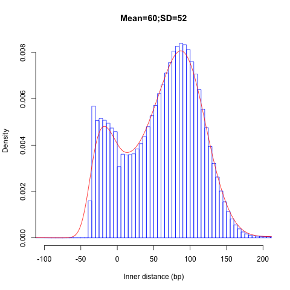

insertion_profile.py
------------------------------------
**Calculate the distributions of inserted nucleotides across reads.**
Note that to use this funciton, CIGAR strings within SAM/BAM file should have 'I' operation

Options:
  --version             show program's version number and exit
  -h, --help            show this help message and exit
  -i INPUT_FILE, --input-file=INPUT_FILE
                        Alignment file in BAM or SAM format.
  -o OUTPUT_PREFIX, --out-prefix=OUTPUT_PREFIX
                        Prefix of output files(s).
  -q MAP_QUAL, --mapq=MAP_QUAL
                        Minimum mapping quality (phred scaled) for an
                        alignment to be considered as "uniquely mapped".
                        default=30
  -s LAYOUT, --sequencing=LAYOUT
                        Sequencing layout. "SE"(single-end) or "PE"(pair-end).

Example::

 $ python2.7 insertion_profile.py -s "PE" -i test.bam -o out

 $ ls -l out.insertion_profile.* |awk '{print $9}'
 out.insertion_profile.r
 out.insertion_profile.R1.pdf
 out.insertion_profile.R2.pdf
 out.insertion_profile.xls

Read-1 insertion profile:

Read-2 insertion profile:

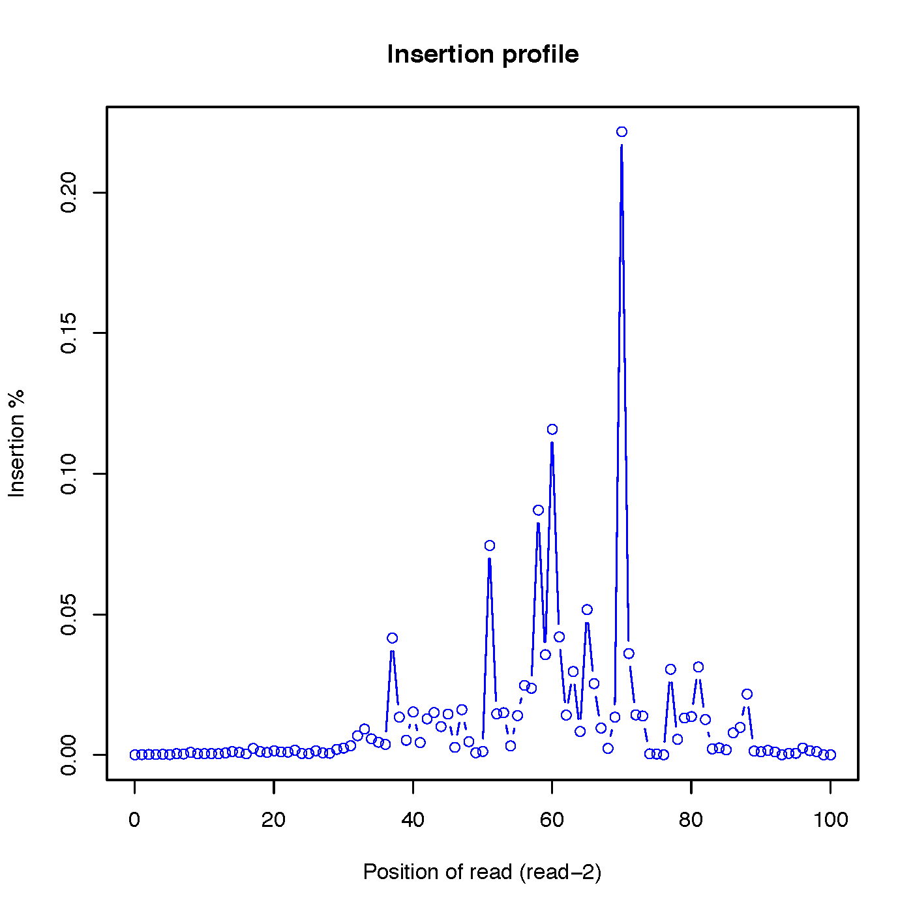

junction_annotation.py
--------------------------------
For a given alignment file (-i) in BAM or SAM format and a reference gene model (-r) in BED
format, this program will compare detected splice junctions to reference gene model. splicing
annotation is performed in two levels: splice event level and splice junction level.

* splice read: An RNA read, especially long read, can be spliced more than once, therefore, 100 spliced reads can produce >= 100 splicing events.
* splice junction: multiple splicing events spanning the same intron can be consolidated into one splicing junction.

Detected junctions were divided to 3 exclusive categories:

1. Annotated (known): The junction is part of the gene model. Both splice sites, 5' splice site
   (5'SS) and 3'splice site (3'SS) are annotated by reference gene model.
2. Complete_novel: Both 5'SS and 3'SS are novel.
3. Partial_novel: One of the splice site (5'SS or 3'SS) is novel, and the other splice site is annotated

Options:
  --version             show program's version number and exit
  -h, --help            show this help message and exit
  -i INPUT_FILE, --input-file=INPUT_FILE
                        Alignment file in BAM or SAM format.
  -r REF_GENE_MODEL, --refgene=REF_GENE_MODEL
                        Reference gene model in bed format. This file is
                        better to be a pooled gene model as it will be used to
                        annotate splicing junctions [required]
  -o OUTPUT_PREFIX, --out-prefix=OUTPUT_PREFIX
                        Prefix of output files(s). [required]
  -m MIN_INTRON, --min-intron=MIN_INTRON
                        Minimum intron length (bp). default=50 [optional]
  -q MAP_QUAL, --mapq=MAP_QUAL
                        Minimum mapping quality (phred scaled) for an
                        alignment to be considered as "uniquely mapped".
                        default=30

Example::

 junction_annotation.py -i Pairend_nonStrandSpecific_36mer_Human_hg19.bam -o output -r hg19.refseq.bed12

Output:

Distribution of **complete_novel**, **partial_novel** and **known** junctions (splicing events).

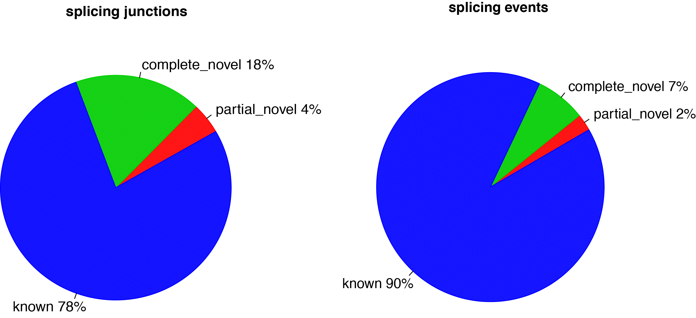

The produced `Interact <https://genome.ucsc.edu/goldenPath/help/interact.html>`_ file can be uploaded into the `UCSC genome browser <https://genome.ucsc.edu>`_ for visualization.
If this file is too large to upload to the `UCSC genome browser <https://genome.ucsc.edu>`_ directly, try to convert this Interact file into bigInteract file (using the `bedToBigBed <http://hgdownload.soe.ucsc.edu/admin/exe/>`_ program following this `instruction <https://genome.ucsc.edu/goldenPath/help/interact.html>`_).
**Complete_novel**, **partial_novel** and **known** junctions will be indicated with arcs of different colors.

junction_saturation.py
-----------------------------
It's very important to check if current sequencing depth is deep enough to perform
alternative splicing analyses. For a well annotated organism, the number of expressed genes
in particular tissue is almost fixed so the number of splice junctions is also fixed. The fixed
splice junctions can be predetermined from reference gene model. All (annotated) splice
junctions should be rediscovered from a saturated RNA-seq data, otherwise, downstream
alternative splicing analysis is problematic because low abundance splice junctions are
missing. This module checks for saturation by resampling 5%, 10%, 15%, ..., 95% of total
alignments from BAM or SAM file, and then detects splice junctions from each subset and
compares them to reference gene model.

Options:
  --version             show program's version number and exit
  -h, --help            show this help message and exit
  -i INPUT_FILE, --input-file=INPUT_FILE
                        Alignment file in BAM or SAM format.[required]
  -o OUTPUT_PREFIX, --out-prefix=OUTPUT_PREFIX
                        Prefix of output files(s). [required]
  -r REFGENE_BED, --refgene=REFGENE_BED
                        Reference gene model in bed fomat. This gene model is
                        used to determine known splicing junctions. [required]
  -l PERCENTILE_LOW_BOUND, --percentile-floor=PERCENTILE_LOW_BOUND
                        Sampling starts from this percentile. A integer
                        between 0 and 100. default=5
  -u PERCENTILE_UP_BOUND, --percentile-ceiling=PERCENTILE_UP_BOUND
                        Sampling ends at this percentile. A integer between 0
                        and 100. default=100
  -s PERCENTILE_STEP, --percentile-step=PERCENTILE_STEP
                        Sampling frequency. Smaller value means more sampling
                        times. A integer between 0 and 100. default=5
  -m MINIMUM_INTRON_SIZE, --min-intron=MINIMUM_INTRON_SIZE
                        Minimum intron size (bp). default=50
  -v MINIMUM_SPLICE_READ, --min-coverage=MINIMUM_SPLICE_READ
                        Minimum number of supportting reads to call a
                        junction. default=1
  -q MAP_QUAL, --mapq=MAP_QUAL
                        Minimum mapping quality (phred scaled) for an
                        alignment to be called "uniquely mapped". default=30

Example::

 junction_saturation.py -i Pairend_nonStrandSpecific_36mer_Human_hg19.bam -r hg19.refseq.bed12 -o output

Output:

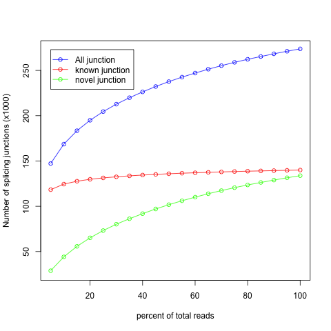

In this example, current sequencing depth is almost saturated for "known junction" (red line)
detection because the number of "known junction" reaches a plateau. In other words, nearly
all "known junctions" (expressed in this particular tissue) have already been detected, and
deeper sequencing will not likely to detect additional "known junction" and will only increase
junction coverage (i.e. junction covered by more reads). While current sequencing depth is
not saturated for novel junctions (green).

mismatch_profile.py
----------------------------
**Calculate the distribution of mismatches across reads.**

**Note that the "MD" tag must exist in BAM file.**

Options:
  --version             show program's version number and exit
  -h, --help            show this help message and exit
  -i INPUT_BAM, --input=INPUT_BAM
                        Input BAM file. [required]
  -l READ_ALIGNMENT_LENGTH, --read-align-length=READ_ALIGNMENT_LENGTH
                        Alignment length of read. It is usually set to the
                        orignial read length. For example, all these cigar
                        strings ("101M", "68M140N33M", "53M1D48M") suggest the
                        read alignment length is 101. [required]
  -o OUTPUT_PREFIX, --out-prefix=OUTPUT_PREFIX
                        Prefix of output files(s). [required]
  -n READ_NUMBER, --read-num=READ_NUMBER
                        Number of aligned reads with mismatches used to
                        calculate the mismatch profile. default=1000000
  -q MAP_QUAL, --mapq=MAP_QUAL
                        Minimum mapping quality. default=30

Example::

 $ python2.7 mismatch_profile.py -l 101 -i ../test.bam -o out

 $ ls -l out.mismatch_profile.* |awk '{print $9}'
 out.mismatch_profile.pdf
 out.mismatch_profile.r
 out.mismatch_profile.xls

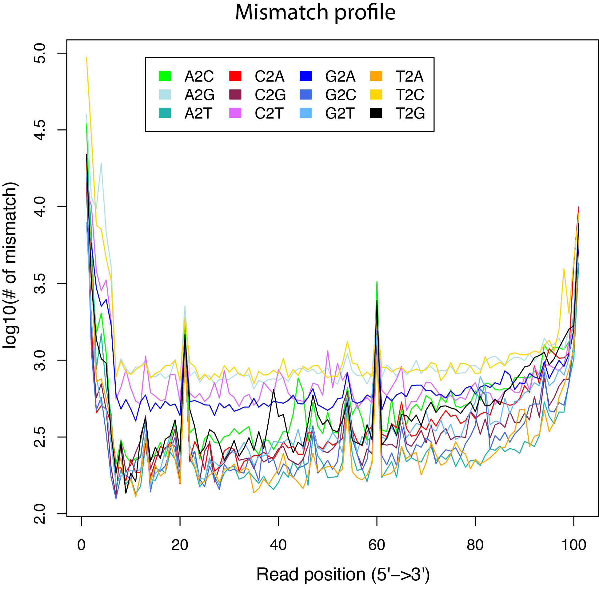

normalize_bigwig.py
--------------------------
Visualizing is the most straightforward and effective way to QC your RNA-seq data. For
example, differential expression can be easily checked by comparing two RNA-seq tracks
using genome browser. However, one must make sure that all samples are comparable before
"visual checking". Signal values in wig (or bigwig) file are contributed form two factors:
1) total read number.
2) read length.
Therefore, only normalized to 'total read count' is problematic if read length is different
between samples. Here we normalize every bigwig file into the same *wigsum*. *wigsum* is the
summary of signal value across the genome. for example, *wigsum* = 100,000,000 equals to the
coverage achieved by 1 million 100nt long reads or 2 million 50nt long reads.

Options:
  --version             show program's version number and exit
  -h, --help            show this help message and exit
  -i BIGWIG_FILE, --bwfile=BIGWIG_FILE
                        Input BigWig file. [required]
  -o OUTPUT_WIG, --output=OUTPUT_WIG
                        Output wig file. [required]
  -s CHROMSIZE, --chromSize=CHROMSIZE
                        Chromosome size file. Tab or space separated text file
                        with 2 columns: first column is chromosome name,
                        second column is size of the chromosome. [required]
  -t TOTAL_WIGSUM, --wigsum=TOTAL_WIGSUM
                        Specified wigsum. 100000000 equals to coverage of 1
                        million 100nt reads. default=100000000  [optional]
  -r REFGENE_BED, --refgene=REFGENE_BED
                        Reference gene model in bed format. [optional]
  -c CHUNK_SIZE, --chunk=CHUNK_SIZE
                        Chromosome chunk size. Each chomosome will be cut into
                        samll chunks of this size. Decrease chunk size will
                        save more RAM. default=500000 (bp) [optional]
  -f OUT_FORMAT, --format=OUT_FORMAT
                        Output format. either "wig" or "bgr". "bgr" save disk
                        space but make program slower. default=bgr

Note:
From RSeQC v3.0.0, the option '-s' was removed. The chromSizes can be calculated from the header
section of biwig file(s) using pyBigWig.

overlay_bigwig.py
----------------------
This module allow users to manipulate two BigWig files.

Options:
  --version             show program's version number and exit
  -h, --help            show this help message and exit
  -i BIGWIG_FILE1, --bwfile1=BIGWIG_FILE1
                        One BigWig file
  -j BIGWIG_FILE2, --bwfile2=BIGWIG_FILE2
                        Another BigWig file
  -a ACTION, --action=ACTION
                        After pairwise align two bigwig files, perform the
                        follow actions (Only select one keyword):"Add" = add
                        signals. "Average" = average signals. "Division"=
                        divide bigwig2 from bigwig1. Add 1 to both bigwig.
                        "Max" = pick the signal that is larger. "Min" = pick
                        the signal that is smaller. "Product" = multiply
                        signals. "Subtract" = subtract signals in 2nd bigwig
                        file from the corresponiding ones in the 1st bigwig
                        file. "geometricMean" = take the geometric mean of
                        signals.
  -o OUTPUT_WIG, --output=OUTPUT_WIG
                        Output wig file
  -s CHROMSIZE, --chromSize=CHROMSIZE
                        Chromosome size file. Tab or space separated text file
                        with 2 columns: first column is chromosome name,
                        second column is size of the chromosome.
  -c CHUNK_SIZE, --chunk=CHUNK_SIZE
                        Chromosome chunk size. Each chomosome will be cut into
                        samll chunks of this size. Decrease chunk size will
                        save more RAM. default=100000 (bp)
  -m MIN_SCORE, --min_signal=MIN_SCORE
                        To redude the size of output wigfile, genomic
                        positions with signal value smaller than (<) this
                        threshold will be filtered out. default=0.0

Note:
From RSeQC v3.0.0, the option '-s' was removed. The chromSizes can be calculated from the header
section of biwig file(s) using pyBigWig.

read_distribution.py
-------------------------
Provided a BAM/SAM file and reference gene model, this module will calculate how mapped
reads were distributed over genome feature (like CDS exon, 5'UTR exon, 3' UTR exon, Intron,
Intergenic regions). When genome features are overlapped (e.g. a region could be annotated
as both exon and intron by two different transcripts) , they are prioritize as:
CDS exons > UTR exons > Introns > Intergenic regions, for example, if a read was mapped to
both CDS exon and intron, it will be assigned to CDS exons.

* "Total Reads": This does NOT include those QC fail,duplicate and non-primary hit reads
* "Total Tags": reads spliced once will be counted as 2 tags, reads spliced twice will be counted as 3 tags, etc. And because of this, "Total Tags" >= "Total Reads"
* "Total Assigned Tags": number of tags that can be unambiguously assigned the 10 groups (see below table).
* Tags assigned to "TSS_up_1kb" were also assigned to "TSS_up_5kb" and "TSS_up_10kb", tags assigned to "TSS_up_5kb" were also assigned to "TSS_up_10kb". Therefore, "Total Assigned Tags" = CDS_Exons + 5'UTR_Exons + 3'UTR_Exons + Introns + TSS_up_10kb + TES_down_10kb.
* When assign tags to genome features, each tag is represented by its middle point.

RSeQC cannot assign those reads that:

* hit to intergenic regions that beyond region starting from TSS upstream 10Kb to TES downstream 10Kb.
* hit to regions covered by both 5'UTR and 3' UTR. This is possible when two head-to-tail transcripts are overlapped in UTR regions.
* hit to regions covered by both TSS upstream 10Kb and TES downstream 10Kb.

Options:
  --version             show program's version number and exit
  -h, --help            show this help message and exit
  -i INPUT_FILE, --input-file=INPUT_FILE
                        Alignment file in BAM or SAM format.
  -r REF_GENE_MODEL, --refgene=REF_GENE_MODEL
                        Reference gene model in bed format.

Example::

 read_distribution.py  -i Pairend_StrandSpecific_51mer_Human_hg19.bam -r hg19.refseq.bed12

Output:

===============     ============        ===========         ===========
Group               Total_bases         Tag_count           Tags/Kb
===============     ============        ===========         ===========
CDS_Exons           33302033            20002271            600.63
5'UTR_Exons         21717577            4408991             203.01
3'UTR_Exons         15347845            3643326             237.38
Introns             1132597354          6325392             5.58
TSS_up_1kb          17957047            215331              11.99
TSS_up_5kb          81621382            392296              4.81
TSS_up_10kb         149730983           769231              5.14
TES_down_1kb        18298543            266161              14.55
TES_down_5kb        78900674            729997              9.25
TES_down_10kb       140361190           896882              6.39
===============     ============        ===========         ===========

read_duplication.py
---------------------------
Two strategies were used to determine reads duplication rate:
* Sequence based: reads with identical sequence are regarded as duplicated reads.
* Mapping based: reads mapped to the exactly same genomic location are regarded as duplicated reads. For splice reads, reads mapped to the same starting position and splice the same way are regarded as duplicated reads.

Options:
  --version             show program's version number and exit
  -h, --help            show this help message and exit
  -i INPUT_FILE, --input-file=INPUT_FILE
                        Alignment file in BAM or SAM format.
  -o OUTPUT_PREFIX, --out-prefix=OUTPUT_PREFIX
                        Prefix of output files(s).
  -u UPPER_LIMIT, --up-limit=UPPER_LIMIT
                        Upper limit of reads' occurrence. Only used for
                        plotting, default=500 (times)
  -q MAP_QUAL, --mapq=MAP_QUAL
                        Minimum mapping quality (phred scaled) for an
                        alignment to be considered as "uniquely mapped".
                        default=30

Example::

 read_duplication.py -i Pairend_nonStrandSpecific_36mer_Human_hg19.bam -o output

Output:

* output.dup.pos.DupRate.xls: Read duplication rate determined from mapping position of read. First column is "occurrence" or duplication times, second column is number of uniquely mapped reads.
* output.dup.seq.DupRate.xls: Read duplication rate determined from sequence of read. First column is "occurrence" or duplication times, second column is number of uniquely mapped reads.
* output.DupRate_plot.r: R script to generate pdf file
* output.DupRate_plot.pdf: graphical output generated from R scrip

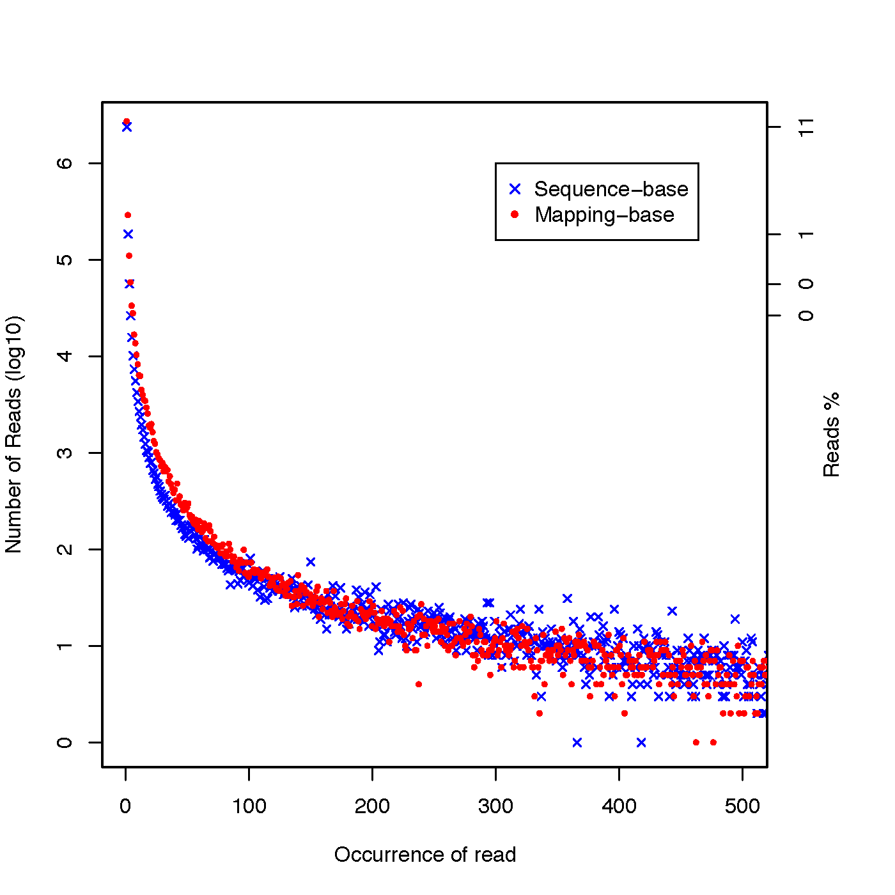

read_GC.py
-------------------
**GC content distribution of reads.**
Options:

  --version             show program's version number and exit
  -h, --help            show this help message and exit
  -i INPUT_FILE, --input-file=INPUT_FILE
                        Alignment file in BAM or SAM format.
  -o OUTPUT_PREFIX, --out-prefix=OUTPUT_PREFIX
                        Prefix of output files(s).
  -q MAP_QUAL, --mapq=MAP_QUAL
                        Minimum mapping quality (phred scaled) for an
                        alignment to be called "uniquely mapped". default=30

Example::

 read_GC.py -i Pairend_nonStrandSpecific_36mer_Human_hg19.bam -o output

Output:

* output.GC.xls: Two column, plain text file, first column is GC%, second column is read count
* output.GC_plot.r: R script to generate pdf file.
* output.GC_plot.pdf: graphical output generated from R script.

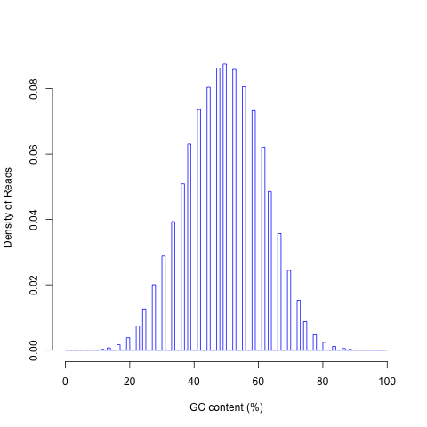

read_hexamer.py
-----------------------
calculate hexamer (6mer) frequency. If '-r' was specified, hexamer frequency was also calculated
for the reference genome. If '-g' was provided, hexamer frequency was also calculated for
the mRNA sequences.

Options:
  --version             show program's version number and exit
  -h, --help            show this help message and exit
  -i INPUT_READ, --input=INPUT_READ
                        Read sequence in fasta or fastq format. Multiple
                        fasta/fastq files should be separated by ','. For
                        example: read.fq,read2.fa,read3,fa
  -r REF_GENOME, --refgenome=REF_GENOME
                        Reference genome sequence in fasta format. Optional
  -g REF_GENE, --refgene=REF_GENE
                        Reference mRNA sequence in fasta format. Optional

read_NVC.py
---------------
This module is used to check the nucleotide composition bias. Due to random priming, certain
patterns are over represented at the beginning (5'end) of reads. This bias could be easily
examined by NVC (Nucleotide versus cycle) plot. NVC plot is generated by overlaying all
reads together, then calculating nucleotide composition for each position of read
(or each sequencing cycle). In ideal condition (genome is random and RNA-seq reads is
randomly sampled from genome), we expect A%=C%=G%=T%=25% at each position of reads.

NOTE: this program expect a fixed read length

Options:
  --version             show program's version number and exit
  -h, --help            show this help message and exit
  -i INPUT_FILE, --input-file=INPUT_FILE
                        Input file in BAM or SAM format.[required]
  -o OUTPUT_PREFIX, --out-prefix=OUTPUT_PREFIX
                        Prefix of output files(s). [required]
  -x, --nx              Flag option. Presense of this flag tells program to
                        include N,X in output NVC plot [required]
  -q MAP_QUAL, --mapq=MAP_QUAL
                        Minimum mapping quality (phred scaled) for an
                        alignment to be called "uniquely mapped". default=30

Example::

 read_NVC.py -i Pairend_nonStrandSpecific_36mer_Human_hg19.bam -o output

Output:

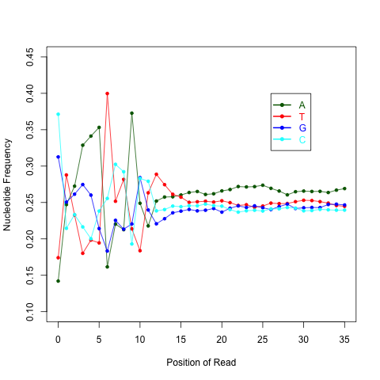

read_quality.py
------------------
According to SAM specification, if Q is the character to represent "base calling quality"
in SAM file, then Phred Quality Score = ord(Q) - 33. Here ord() is python function that
returns an integer representing the Unicode code point of the character when the argument
is a unicode object, for example, ord('a') returns 97. Phred quality score is widely used
to measure "reliability" of base-calling, for example, phred quality score of 20 means
there is 1/100 chance that the base-calling is wrong, phred quality score of 30 means there
is 1/1000 chance that the base-calling is wrong. In general: Phred quality score = -10xlog(10)P,
here P is probability that base-calling is wrong.

Options:
  --version             show program's version number and exit
  -h, --help            show this help message and exit
  -i INPUT_FILE, --input-file=INPUT_FILE
                        Alignment file in BAM or SAM format. [required]
  -o OUTPUT_PREFIX, --out-prefix=OUTPUT_PREFIX
                        Prefix of output files(s). [required]
  -r REDUCE_FOLD, --reduce=REDUCE_FOLD
                        To avoid making huge vector in R, nucleotide with
                        particular phred score less frequent than this number
                        will be ignored. Increase this number save more memory
                        while reduce precision. Set to 1 achieve maximum
                        precision (i.e. every nucleotide will be considered).
                        This option only applies to the 'boxplot'.
                        default=1000
  -q MAP_QUAL, --mapq=MAP_QUAL
                        Minimum mapping quality (phred scaled) for an
                        alignment to be called "uniquely mapped". default=30

Example::

 read_quality.py -i Pairend_nonStrandSpecific_36mer_Human_hg19.bam -o output

Output:

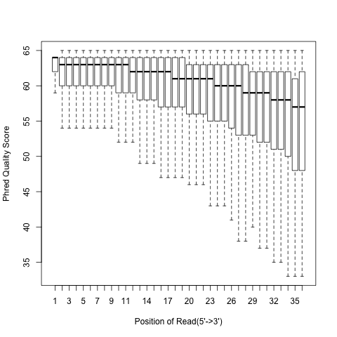

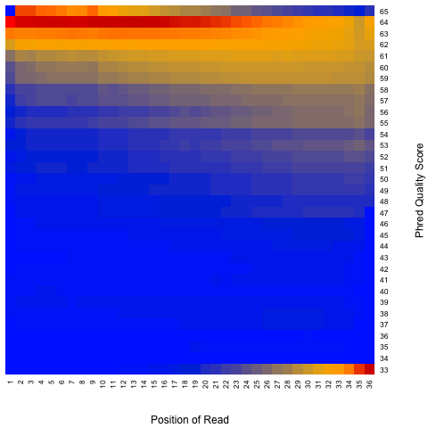

Heatmap: use different color to represent nucleotide density ("blue"=low density,"orange"=median density,"red"=high density")

sc_bamStat.py -h
-----------------
This program reports single cell RNA-seq (scRNA-seq) reads mapping statistics. It needs the BAM file generated by the `Cell Ranger <https://support.10xgenomics.com/single-cell-gene-expression/software/pipelines/latest/output/bam>`_ workflow.

Options:
  --version             show program's version number and exit
  -h, --help            show this help message and exit
  -i BAM_FILE, --infile=BAM_FILE
                        Input file in BAM foramt. Must have BAM alignment tags
                        indicated below.
  --cb-tag=CB_TAG       BAM alignment tag. Used to indicate error-corrected
                        cellular barcode. default='CB'
  --re-tag=RE_TAG       BAM alignment tag. Used to indicate the region type of
                        the alignment (E = exonic, N = intronic, I =
                        intergenic). default='RE'
  --tx-tag=TX_TAG       BAM alignment tag. Used to indicate reads aligned to
                        the same strand as the annotated transcripts.
                        default='TX'
  --an-tag=AN_TAG       BAM alignment tag. Used to indicate reads aligned to
                        the antisense strand of the annotated transcripts.
                        default='AN'
  --umi-tag=UMI_TAG     BAM alignment tag. Used to indicat the error-corrected
                        UMI. default='UB'
  --xf-tag=XF_TAG       BAM alignment tag. Used to indicate reads confidently
                        mapped to the feature. default='xf'
  --chrM-id=MIT_CONTIG_NAME
                        The name of mitochondrial chromosome in BAM file.
                        default='chrM'
  --verbose             Logical to determine if detailed running information
                        is printed to screen.

Example (the test BAM file can be downloaded from `here <https://sourceforge.net/projects/rseqc/files/scRNAseq_test/>`_)::

 $ sc_bamStat.py -i possorted_genome_bam.bam
 2022-10-14 08:54:01 [INFO]  Reading BAM file "possorted_genome_bam.bam" ...
 2022-10-14 08:54:01 [INFO]  Processing "chr21.part" ...
 2022-10-14 08:54:03 [INFO]  Processed 248429 alignments from "chr21.part"
 2022-10-14 08:54:04 [INFO]  Processing "chrM" ...
 2022-10-14 08:54:04 [INFO]  Processed 32 alignments from "chrM"
 2022-10-14 08:54:04 [INFO]  Processing "GL000220.1" ...
 2022-10-14 08:54:04 [INFO]  Processed 47671 alignments from "GL000220.1"
 2022-10-14 08:54:04 [INFO]  Processing total 296132 alignments mapped to all chromosomes.
 2022-10-14 08:54:04 [INFO]  Count total mapped reads ...
 2022-10-14 08:54:05 [INFO]  Count confidently mapped reads ...
 2022-10-14 08:54:05 [INFO]  Removing intermediate files ...
  
 
 Total_alignments: 296132
 └--Confident_alignments: 95920
 
 Total_mapped_reads: 296132
 |--Non_confidently_mapped_reads:  200212  (67.61%)
 └--Confidently_mapped_reads:  95920 (32.39%)
    |--Reads_with_PCR_duplicates:  65011 (67.78%)
    └--Reads_no_PCR_duplicates:  30909 (32.22%)
 
    |--Reads_map_to_forward(Waston)_strand:  36475 (38.03%)
    └--Reads_map_to_Reverse(Crick)_strand: 59445 (61.97%)
 
    |--Reads_map_to_sense_strand:  95920 (100.00%)
    └--Reads_map_to_antisense_strand:  0 (0.00%)
    └--Other:  0 (0.00%)
 
    |--Reads_map_to_exons: 95920 (100.00%)
    └--Reads_map_to_introns: 0 (0.00%)
    └--Reads_map_to_intergenic:  0 (0.00%)
    └--Other:  0 (0.00%)
 
    |--Reads_with_error-corrected_barcode: 94049 (98.05%)
    └--Reads_no_error-corrected_barcode: 1871  (1.95%)
 
    |--Reads_with_error-corrected_UMI: 95854 (99.93%)
    └--Reads_no_error-corrected_UMI: 66  (0.07%)
 
    |--Reads_map_to_mitochonrial_genome: 0 (0.00%)
    └--Reads_map_to_nuclear_genome:  95920 (100.00%)
 
    |--Map_consecutively:  76543 (79.80%)
    |--Map_with_clipping:  8018  (8.36%)
    |--Map_with_splicing:  8744  (9.12%)
    |--Map_with_splicing_and_clipping: 516 (0.54%)
    └--Others: 2099  (2.19%)
 
 2022-10-14 08:54:05 [INFO]  Done.

sc_seqLogo.py -h
----------------

This program generates a DNA sequence logo from `FASTA <https://en.wikipedia.org/wiki/FASTA>`_ or `FASTQ <https://en.wikipedia.org/wiki/FASTQ_format>`_ format file. It is useful to visualize the nucleotide compositions of "sample barcode", "cell barcode" and UMI (`Unique molecular identifier <https://en.wikipedia.org/wiki/Unique_molecular_identifier>`_).

After running the :code:`cellranger mkfastq` (`link <https://support.10xgenomics.com/single-cell-gene-expression/software/pipelines/latest/using/tutorial_fq>`_), we will get three types of `FASTQ <https://en.wikipedia.org/wiki/FASTQ_format>`_ files from 10X Single Cell 3’ Library:

* **I1 fastq file**. This files contains the 8 bp sample barcodes. Sample barcode is used to **demultiplexing** (i.e., sort sequenced reads into separate files for different samples that were pooled together during sequencing). 
* **R1 fastq file**. This file contains 26 bp sequences (16 bp cell barcode + 10 bp UMI). Note, Chromium Single Cell 3' Solution V3 use 12 bp UMI. 
* **R2 fastq file**. This file contains the actual cDNA reads which can be mapped to the transcriptome.
  
 
Options:
   --version             show program's version number and exit
   -h, --help            show this help message and exit
   -i IN_FILE, --infile=IN_FILE
                         Input DNA sequence file in `FASTQ
                         <https://en.wikipedia.org/wiki/FASTQ_format#>`_, `FASTA
                         <https://en.wikipedia.org/wiki/FASTA_format>`_ or pure
                         sequence format (i.e., each DNA sequence per row). All sequences must be the same
                         length. This file can be plain text or compressed
                         format (".gz", ".Z",".z",".bz", ".bz2", ".bzip2").
   -o OUT_FILE, --outfile=OUT_FILE
                         The prefix of output files.
   --iformat=IN_FORMAT   The format of input file. Must be 'fq' or 'fa'.
                         default='fq'
   --oformat=OUT_FORMAT  The format of output logo file. Must be 'pdf', 'png'
                         or 'svg'. default='pdf'
   -n MAX_SEQ, --nseq-limit=MAX_SEQ
                         Only process this many sequences and stop.
                         default=none (generate logo fromALL sequences).
   --font-name=FONT_NAME
                         The font of logo characters. For a list of valid font
                         names, run logomaker.list_font_names().default='sans'
   --stack-order=STACK_ORDER
                         Must be 'big_on_top', 'small_on_top', or 'fixed'.
                         'big_on_top' : nucleotide with the highestfrequency
                         will be on the top; 'small_on_top' : nucleotide with
                         the lowest frequency will be on thetop; 'fixed' :
                         nucleotides from top to bottom are in the same order
                         as characters appear in thedata frame.
                         default='big_on_top'
   --flip-below          If set, characters below the X-axis (which correspond
                         to negative values in the matrix)will be flipped
                         upside down. default=False
   --shade-below=SHADE_BELOW
                         The amount of shading to use for characters drawn
                         below the X-axis. 0 <= shade_below <= 1.Larger values
                         correspond to more shading. default=0.0
   --fade-below=FADE_BELOW
                         The amount of fading to use for characters drawn below
                         the X-axis. 0 <= shade_below <= 1. Larger values
                         correspond to more fading. default=0.0
   --excludeN            If set, exclude all DNA sequences containing "N".
   --highlight-start=HI_START
                         Highlight logo from this position. Must be within [0,
                         sequence_length-1].default=none (no highlight)
   --highlight-end=HI_END
                         Highlight logo to this position. Must be within [0,
                         len(logo)-1].default=none (no highlight)
   --verbose             If set, print detailed information for debugging.

Example-1: generate sequence logo for read-1. The test fastq file is available from `here <https://sourceforge.net/projects/rseqc/files/scRNAseq_test/test_sample_S1_L001_R1_001.fastq.gz>`_::

 $ sc_seqLogo.py -i test_sample_S1_L001_R1_001.fastq.gz  --highlight-start=0 --highlight-end=15 -o output_R1
 
 2022-10-14 09:37:20 [INFO]  Reading FASTQ file "test_sample_S1_L001_R1_001.fastq.gz" ...
 2022-10-14 09:37:20 [INFO]  88 sequences finished
 2022-10-14 09:37:20 [INFO]  Make data frame from dict of dict ...
 2022-10-14 09:37:20 [INFO]  Filling NA as zero ...
 2022-10-14 09:37:20 [INFO]  Making logo ...
 2022-10-14 09:37:20 [INFO]  'N' will be kept.
 2022-10-14 09:37:20 [INFO]  Mean-centered logo saved to "output_R1.logo_mean_centered.pdf".
 2022-10-14 09:37:20 [INFO]  Highlight logo from 0 to 15
 2022-10-14 09:37:20 [INFO]  Logo saved to "output_R1.logo.pdf".

Sequence logo for read_1 (cell barcode + UMI). The first 16 nt (cell barcode) are highlighted.

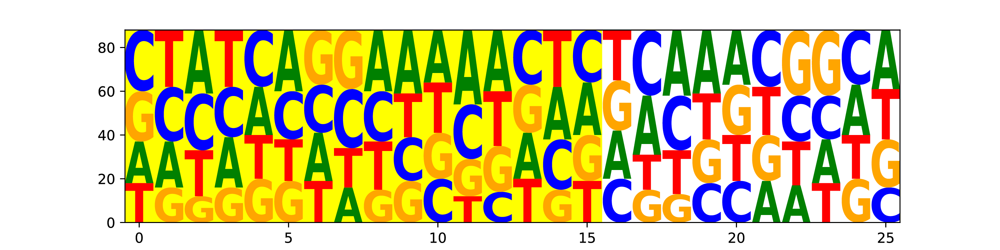

Sequence logo (mean-centered) for read_1 (cell barcode + UMI). The first 16 nt (cell barcode) are highlighted.

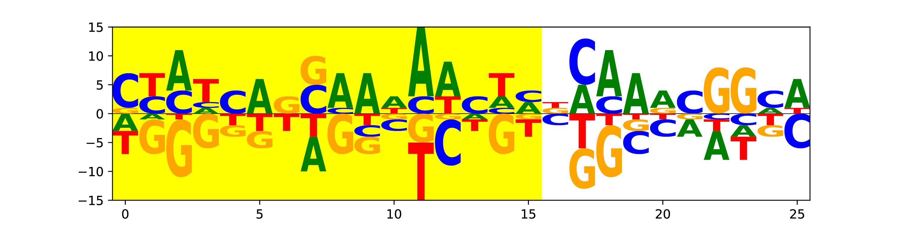

Example-2: generate sequence logo for sample barcode. The test fastq file is available from `here <https://sourceforge.net/projects/rseqc/files/scRNAseq_test/test_sample_S1_L001_I1_001.fastq.gz/>`_::
 
 $ sc_seqLogo.py -i test_sample_S1_L001_I1_001.fastq.gz -o output_I1

 2022-10-14 09:54:07 [INFO]  Reading FASTQ file "test_sample_S1_L001_I1_001.fastq.gz" ...
 2022-10-14 09:54:07 [INFO]  88 sequences finished
 2022-10-14 09:54:07 [INFO]  Make data frame from dict of dict ...
 2022-10-14 09:54:07 [INFO]  Filling NA as zero ...
 2022-10-14 09:54:07 [INFO]  Making logo ...
 2022-10-14 09:54:07 [INFO]  'N' will be kept.
 2022-10-14 09:54:07 [INFO]  Mean-centered logo saved to "output_I1.logo_mean_centered.pdf".
 2022-10-14 09:54:08 [INFO]  Logo saved to "output_I1.logo.pdf".

Sequence logo for 8nt sample barcode.

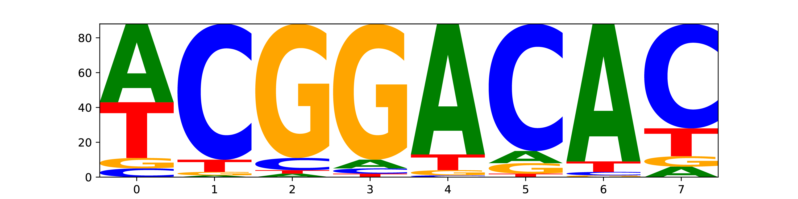

Sequence logo (mean-centered) for 8nt sample barcode.

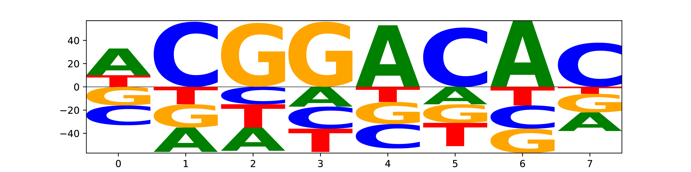

sc_seqQual.py
-------------

This program generates heatmap from a `FASTQ <https://en.wikipedia.org/wiki/FASTQ_format>`_  file to visualize the sequencing quality.

.. NOTE::

   This function requires the `pheatmap <https://cran.r-project.org/web/packages/pheatmap/pheatmap.pdf>`_ R package.
 
 
Options:
   --version             show program's version number and exit
   -h, --help            show this help message and exit
   -i IN_FILE, --infile=IN_FILE
                         Input file in FASTQ
                         (https://en.wikipedia.org/wiki/FASTQ_format#) format.
   -o OUT_FILE, --outfile=OUT_FILE
                         The prefix of output files.
   -n MAX_SEQ, --nseq-limit=MAX_SEQ
                         Only process this many sequences and stop.
                         default=none (generate logo from ALL sequences).
   --cell-width=CELL_WIDTH
                         Cell width (in points) of the heatmap. default=12
   --cell-height=CELL_HEIGHT
                         Cell height (in points) of the heatmap. default=10
   --font-size=FONT_SIZE
                         Font size in points. If --display-num was set,
                         fontsize_number = 0.8 * font_size. default=6
   --angle=COL_ANGLE     The angle (must be 0, 45, 90, 270, 315) of column text
                         lables under the heatmap. default=45
   --text-color=TEXT_COLOR
                         The color of numbers in each cell. default=black
   --file-type=FILE_TYPE
                         The file type of heatmap. Choose one of 'pdf', 'png',
                         'tiff', 'bmp', 'jpeg'. default=pdf
   --no-num              if set, will not print numerical values to cells.
                         default=False
   --verbose             If set, will produce detailed information for
                         debugging.

Example: generate the heatmap of R2 sequencing quality. The test fastq file is available from `here <https://sourceforge.net/projects/rseqc/files/scRNAseq_test/test_sample_S1_L001_R2_001.fastq.gz/>`_::

 $ sc_seqQual.py -i test_sample_S1_L001_R2_001.fastq.gz -o R2_qual
 2022-10-16 05:40:00 [INFO]  Reading FASTQ file "test_sample_S1_L001_R2_001.fastq.gz" ...
 2022-10-16 05:40:00 [INFO]  88 quality sequences finished
 2022-10-16 05:40:00 [INFO]  Make data frame from dict of dict ...
 2022-10-16 05:40:00 [INFO]  Filling NA as zero ...
 2022-10-16 05:40:00 [INFO]  Note: NumExpr detected 16 cores but "NUMEXPR_MAX_THREADS" not set, so enforcing safe limit of 8.
 2022-10-16 05:40:00 [INFO]  NumExpr defaulting to 8 threads.
 2022-10-16 05:40:00 [INFO]  Writing R code to "R2_qual.qual_heatmap.r"
 2022-10-16 05:40:00 [INFO]  Displayed numerical values on heatmap
 2022-10-16 05:40:00 [INFO]  Running R script file "R2_qual.qual_heatmap.r"
 Loading required package: pheatmap

In this heatmap, the X-aixs represents the nucleotide position of read, the Y-aixs represents quality score, and color represents frequencies ("percent of reads"). 

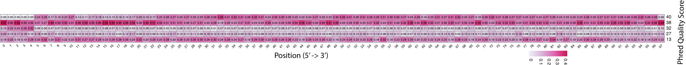

sc_editMatrix.py
----------------
Barcodes from read-1 are not always the same as those in the `whilte list <https://kb.10xgenomics.com/hc/en-us/articles/115004506263>`_. Cell Ranger use `algorithems <https://kb.10xgenomics.com/hc/en-us/articles/115003822406-How-does-Cell-Ranger-correct-barcode-sequencing-errors->`_ to correct putative barcode sequences against the whitelist. 
This program generates heatmaps to visualize where are those **corrections** (i.e., the X-axis), type of **corrections** (Y-axis, such as "C" to "T") and  **frequencies of corrections** (color) of the cell barcodes and UMIs.

.. NOTE::

   This function requires the `pheatmap <https://cran.r-project.org/web/packages/pheatmap/pheatmap.pdf>`_ R package.

Options:
   --version             show program's version number and exit
   -h, --help            show this help message and exit
   -i IN_FILE, --infile=IN_FILE
                         Input file in BAM foramt.
   -o OUT_FILE, --outfile=OUT_FILE
                         The prefix of output files.
   --limit=READS_NUM     Number of alignments to process. default=none
   --cr-tag=CR_TAG       Tag of cellular barcode reported by the sequencer in
                         BAM file. default='CR'
   --cb-tag=CB_TAG       Tag of error-corrected cellular barcode in BAM file.
                         default='CB'
   --ur-tag=UR_TAG       Tag of UMI reported by the sequencer in BAM file.
                         default='UR'
   --ub-tag=UB_TAG       Tag of error-corrected UMI in BAM file. default='UB'
   --cell-width=CELL_WIDTH
                         Points of cell width in the heatmap. default=15
   --cell-height=CELL_HEIGHT
                         Points of cell height in the heatmap. default=10
   --font-size=FONT_SIZE
                         Font size. If --display-num was set, fontsize_number =
                         0.8 * font_size. default=8
   --angle=COL_ANGLE     The angle (must be 0, 45, 90, 270, 315) of column text
                         lables under the heatmap. default=45
   --text-color=TEXT_COLOR
                         The color of numbers in each cell. default=black
   --file-type=FILE_TYPE
                         The file type of heatmap. Choose one of 'pdf', 'png',
                         'tiff', 'bmp', 'jpeg'. default=pdf
   --verbose             If set, detailed running information is printed to
                         screen.
   --no-num              If set, will not print numerical values to cells.
                         default=False

Example::

 $ sc_editMatrix.py -i possorted_genome_bam.bam -o output

 2022-10-16 06:14:59 [INFO]  Reading BAM file "possorted_genome_bam.bam" ...
 2022-10-16 06:15:02 [INFO]  Total alignments processed: 461084
 2022-10-16 06:15:02 [INFO]  Number of alignmenets with <cell barcode> kept AS IS: 426239
 2022-10-16 06:15:02 [INFO]  Number of alignmenets with <cell barcode> edited: 10928
 2022-10-16 06:15:02 [INFO]  Number of alignmenets with <cell barcode> missing: 23916
 2022-10-16 06:15:02 [INFO]  Number of alignmenets with UMI kept AS IS: 459003
 2022-10-16 06:15:02 [INFO]  Number of alignmenets with UMI edited: 1741
 2022-10-16 06:15:02 [INFO]  Number of alignmenets with UMI missing: 339
 2022-10-16 06:15:02 [INFO]  Writing cell barcode frequencies to "output.CB_freq.tsv"
 2022-10-16 06:15:02 [INFO]  Writing UMI frequencies to "output.UMI_freq.tsv"
 2022-10-16 06:15:02 [INFO]  Writing the nucleotide editing matrix (count) of cell barcode to "output.CB_edits_count.csv"
 2022-10-16 06:15:02 [INFO]  Writing the nucleotide editing matrix of molecular barcode (UMI) to "output.UMI_edits_count.csv"
 2022-10-16 06:15:02 [INFO]  Writing R code to "output.CB_edits_heatmap.r"
 2022-10-16 06:15:02 [INFO]  Displayed numerical values on heatmap
 2022-10-16 06:15:02 [INFO]  Numbers will be displayed on log2 scale
 2022-10-16 06:15:02 [INFO]  Running R script file "output.CB_edits_heatmap.r"
 Loading required package: pheatmap
 2022-10-16 06:15:03 [INFO]  Writing R code to "output.UMI_edits_heatmap.r"
 2022-10-16 06:15:03 [INFO]  Displayed numerical values on heatmap
 2022-10-16 06:15:03 [INFO]  Numbers will be displayed on log2 scale
 2022-10-16 06:15:03 [INFO]  Running R script file "output.UMI_edits_heatmap.r"
 Loading required package: pheatmap

Two heatmaps were generated.

Cell barcode

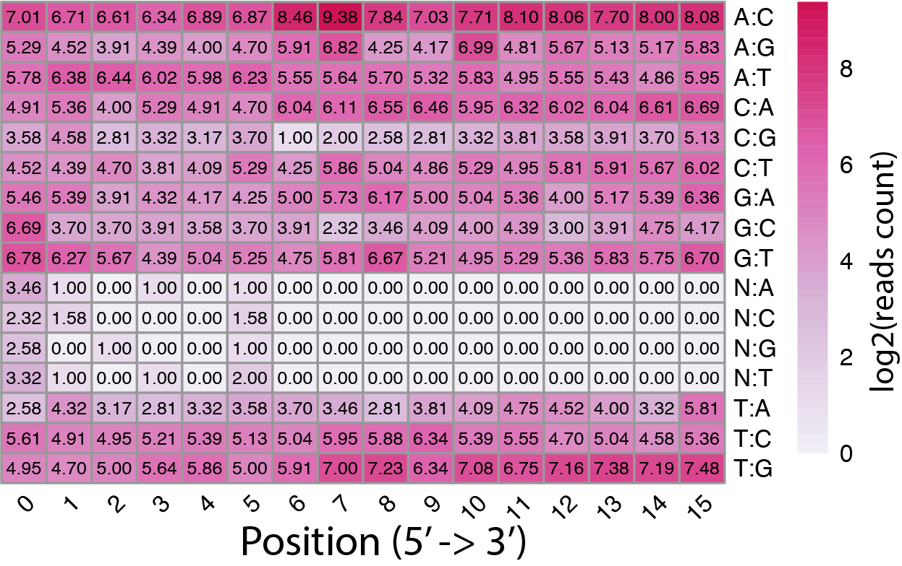

UMI

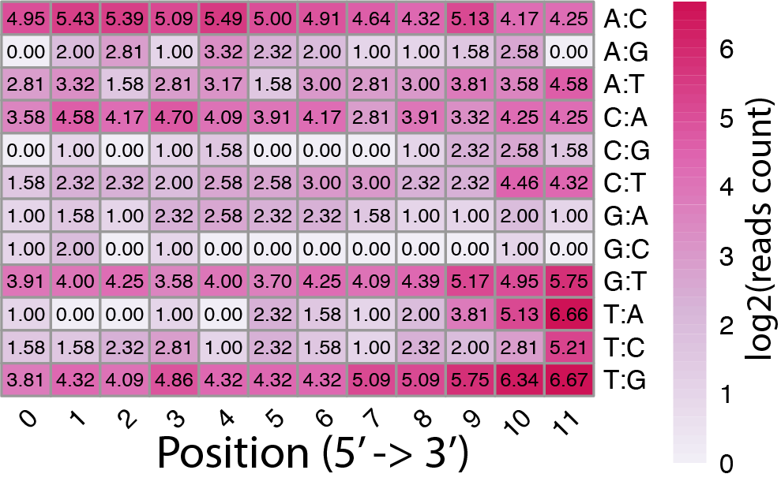

RNA_fragment_size.py
----------------------

Calculate fragment size for each gene/transcript. For each transcript, it will report :
1) Number of fragment that was used to estimate mean, median, std (see below).
2) mean of fragment size
3) median of fragment size
4) stdev of fragment size

Options:
  --version             show program's version number and exit
  -h, --help            show this help message and exit
  -i INPUT_FILE, --input=INPUT_FILE
                        Input BAM file
  -r REFGENE_BED, --refgene=REFGENE_BED
                        Reference gene model in BED format. Must be strandard
                        12-column BED file. [required]
  -q MAP_QUAL, --mapq=MAP_QUAL
                        Minimum mapping quality (phred scaled) for an
                        alignment to be called "uniquely mapped". default=30
  -n FRAGMENT_NUM, --frag-num=FRAGMENT_NUM
                        Minimum number of fragment. default=3

Example::

 $ python2.7 RNA_fragment_size.py -r hg19.RefSeq.union.bed -i SRR873822_RIN10.bam > SRR873822_RIN10.fragSize
 $ head -4 SRR873822_RIN10.fragSize
 chrom	tx_start	tx_end	symbol	frag_count	frag_mean	frag_median	frag_std
 chr10	101542354	101611949	ABCC2	87	210.103448276	177.0	110.746789423
 chr10	124768428	124817806	ACADSB	769	186.657997399	160.0	87.9515992717
 chr10	114133915	114188138	ACSL5	122	183.475409836	157.5	85.1940132118

RPKM_count.py
-------------

.. Note::
   This has been replaced by :code:`FPKM_count.py`

RPKM_saturation.py
-----------------------
The precision of any sample statitics (RPKM) is affected by sample size (sequencing depth);
“resampling” or “jackknifing” is a method to estimate the precision of sample statistics by
using subsets of available data. This module will resample a series of subsets from total RNA
reads and then calculate RPKM value using each subset. By doing this we are able to check if
the current sequencing depth was saturated or not (or if the RPKM values were stable or not)
in terms of genes' expression estimation. If sequencing depth was saturated, the estimated
RPKM value will be stationary or reproducible. By default, this module will calculate 20
RPKM values (using 5%, 10%, ... , 95%,100% of total reads) for each transcripts.

In the output figure, Y axis is "Percent Relative Error" or "Percent Error" which is used
to measures how the RPKM estimated from subset of reads (i.e. RPKMobs) deviates from real
expression level (i.e. RPKMreal). However, in practice one cannot know the RPKMreal. As a
proxy, we use the RPKM estimated from total reads to approximate RPKMreal.

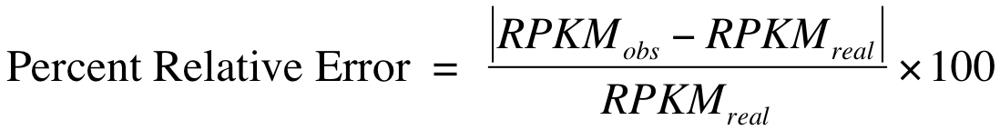

Options:
  --version             show program's version number and exit
  -h, --help            show this help message and exit
  -i INPUT_FILE, --input-file=INPUT_FILE
                        Alignment file in BAM or SAM format. [required]
  -o OUTPUT_PREFIX, --out-prefix=OUTPUT_PREFIX
                        Prefix of output files(s). [required]
  -r REFGENE_BED, --refgene=REFGENE_BED
                        Reference gene model in bed fomat. [required]
  -d STRAND_RULE, --strand=STRAND_RULE
                        How read(s) were stranded during sequencing. For
                        example: --strand='1++,1--,2+-,2-+' means that this is
                        a pair-end, strand-specific RNA-seq, and the strand
                        rule is: read1 mapped to '+' => parental gene on '+';
                        read1 mapped to '-' => parental gene on '-'; read2
                        mapped to '+' => parental gene on '-'; read2 mapped to
                        '-' => parental gene on '+'.  If you are not sure
                        about the strand rule, run 'infer_experiment.py'
                        default=none (Not a strand specific RNA-seq data)
  -l PERCENTILE_LOW_BOUND, --percentile-floor=PERCENTILE_LOW_BOUND
                        Sampling starts from this percentile. A integer
                        between 0 and 100. default=5
  -u PERCENTILE_UP_BOUND, --percentile-ceiling=PERCENTILE_UP_BOUND
                        Sampling ends at this percentile. A integer between 0
                        and 100. default=100
  -s PERCENTILE_STEP, --percentile-step=PERCENTILE_STEP
                        Sampling frequency. Smaller value means more sampling
                        times. A integer between 0 and 100. default=5
  -c RPKM_CUTOFF, --rpkm-cutoff=RPKM_CUTOFF
                        Transcripts with RPKM smaller than this number will be
                        ignored in visualization plot. default=0.01
  -q MAP_QUAL, --mapq=MAP_QUAL
                        Minimum mapping quality (phred scaled) for an
                        alignment to be called "uniquely mapped". default=30

Example::

 RPKM_saturation.py -r hg19.refseq.bed12 -d '1++,1--,2+-,2-+' -i Pairend_StrandSpecific_51mer_Human_hg19.bam -o output

Output:

* output..eRPKM.xls: RPKM values for each transcript
* output.rawCount.xls: Raw count for each transcript
* output.saturation.r: R script to generate plot
* output.saturation.pdf:

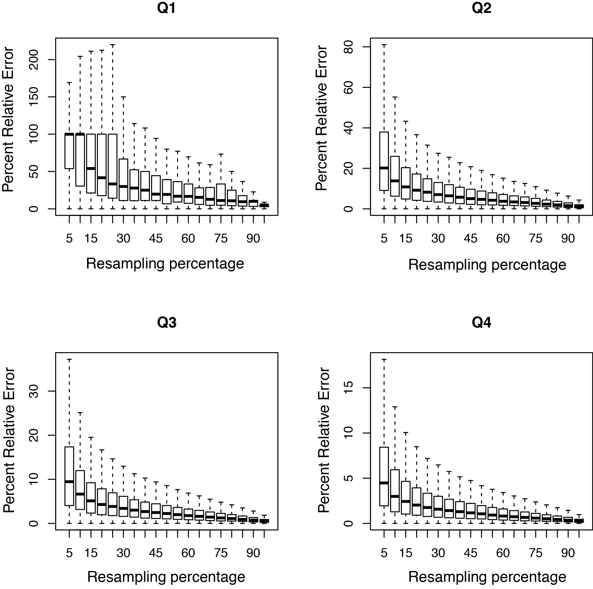

All transcripts were sorted in ascending order according to expression level (RPKM). Then they are divided into 4 groups:

* Q1 (0-25%): Transcripts with expression level ranked below 25 percentile.
* Q2 (25-50%): Transcripts with expression level ranked between 25 percentile and 50 percentile.
* Q3 (50-75%): Transcripts with expression level ranked between 50 percentile and 75 percentile.
* Q4 (75-100%): Transcripts with expression level ranked above 75 percentile.

BAM/SAM file containing more than 100 million alignments will make module very slow.
Follow example below to visualize a particular transcript (using R console)::

 pdf("xxx.pdf")     #starts the graphics device driver for producing PDF graphics
 x <- seq(5,100,5)  #resampling percentage (5,10,15,...,100)
 rpkm <- c(32.95,35.43,35.15,36.04,36.41,37.76,38.96,38.62,37.81,38.14,37.97,38.58,38.59,38.54,38.67, 38.67,38.87,38.68,  38.42,  38.23)  #Paste RPKM values calculated from each subsets
 scatter.smooth(x,100*abs(rpkm-rpkm[length(rpkm)])/(rpkm[length(rpkm)]),type="p",ylab="Precent Relative Error",xlab="Resampling Percentage")
 dev.off()          #close graphical device

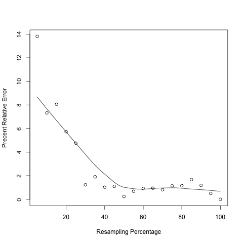

spilt_bam.py
-----------------------

Provide gene list (bed) and BAM file, this module will split the original BAM file into 3 small BAM files:

1. \*.in.bam: reads that are mapped to exon regions of the gene list (or reads consumed by gene list).
2. \*.ex.bam: reads that cannot be mapped the exon regions of the original gene list.
3. \*.junk.bam: qcfailed reads or unmapped reads.

It is particular useful if the input gene list is ribosomal RNA, in this situation, user can estimate how many reads
are originated from ribosomal RNA.
`Download rRNA <http://dldcc-web.brc.bcm.edu/lilab/liguow/CGI/rseqc/_build/html/index.html#download-ribosome-rna-update-to-08-17-2012>`_

Options:
  --version             show program's version number and exit
  -h, --help            show this help message and exit
  -i INPUT_FILE, --input-file=INPUT_FILE
                        Alignment file in BAM or SAM format. BAM file should
                        be sorted and indexed.
  -r GENE_LIST, --genelist=GENE_LIST
                        Gene list in bed foramt. All reads hits to exon
                        regions (defined by this gene list) will be saved into
                        one BAM file, the remaining reads will saved into
                        another BAM file.
  -o OUTPUT_PREFIX, --out-prefix=OUTPUT_PREFIX
                        Prefix of output BAM files. "prefix.in.bam" file
                        contains reads mapped to the gene list specified by
                        "-r", "prefix.ex.bam" contains reads that cannot
                        mapped to gene list. "prefix.junk.bam" contains
                        qcfailed or unmapped reads.

Example::

 python2.7  split_bam.py -i Pairend_StrandSpecific_51mer_Human_hg19.bam  -r hg19.rRNA.bed -o output

 #Output

 Total records:                                         44826454
 output.in.bam (Reads consumed by input gene list):        5185
 output.ex.bam (Reads not consumed by input gene list):    44821269
 output.junk.bam (qcfailed, unmapped reads):                 0

split_paired_bam.py
---------------------
Split bam file (pair-end) into 2 single-end bam file

Options:
  --version             show program's version number and exit
  -h, --help            show this help message and exit
  -i INPUT_FILE, --input-file=INPUT_FILE
                        Alignment file in BAM or SAM format. BAM file should
                        be sorted and indexed
  -o OUTPUT_PREFIX, --out-prefix=OUTPUT_PREFIX
                        Prefix of output BAM files. "prefix.R1.bam" file
                        contains the 1st read, "prefix.R2.bam" file contains
                        the 2nd read

tin.py
-----------------------
This program is designed to evaluate RNA integrity at **transcript** level. `TIN (transcript
integrity number) <http://bmcbioinformatics.biomedcentral.com/articles/10.1186/s12859-016-0922-z>`_ is named in analogous to `RIN (RNA integrity number) <http://www.genomics.agilent.com/article.jsp?pageId=2181>`_.
`RIN (RNA integrity number) <http://www.genomics.agilent.com/article.jsp?pageId=2181>`_
is the most widely used metric to evaluate RNA integrity at **sample (or transcriptome)** level.
It is a very useful preventive measure to ensure good RNA quality and robust, reproducible
RNA sequencing. However, it has several weaknesses:

* RIN score (1 <= RIN <= 10) is not a direct measurement of **mRNA** quality. RIN score heavily relies on the amount of 18S and 28S ribosome RNAs, which was demonstrated by the four features used by the RIN algorithm: the “total RNA ratio” (i.e. the fraction of the area in the region of 18S and 28S compared to the total area under the curve), 28S-region height, 28S area ratio and the 18S:28S ratio24. To a large extent, RIN score was a measure of ribosome RNA integrity. However, in most RNA-seq experiments, ribosome RNAs were depleted from the library to enrich mRNA through either ribo-minus or polyA selection procedure.

* RIN only measures the overall RNA quality of an RNA sample. However, in real situation, the degradation rate may differs significantly among transcripts, depending on factors such as "AU-rich sequence", "transcript length", "GC content", "secondary structure" and the "RNA-protein complex". Therefore, RIN is practically not very useful in downstream analysis such as adjusting the gene expression count.

* RIN has very limited sensitivity to measure substantially degraded RNA samples such as preserved clinical tissues. (ref: http://www.illumina.com/documents/products/technotes/technote-truseq-rna-access.pdf).

To overcome these limitations, we developed TIN, an algorithm that is able to measure RNA integrity at transcript level. TIN calculates a score (0 <= TIN <= 100) for each expressed transcript, however, the medTIN (i.e. meidan TIN score across all the transcripts) can also be used to measure the RNA integrity at **sample** level. Below plots demonstrated TIN is a useful metric to measure RNA integrity in both transcriptome-wise and transcript-wise, as demonstrated by the high concordance with both RIN and RNA fragment size (estimated from RNA-seq read pairs).

Options:
  --version             show program's version number and exit
  -h, --help            show this help message and exit
  -i INPUT_FILES, --input=INPUT_FILES
                        Input BAM file(s). "-i" takes these input: 1) a single
                        BAM file. 2) "," separated BAM files (no spaces
                        allowed). 3) directory containing one or more bam
                        files. 4) plain text file containing the path of one
                        or more bam file (Each row is a BAM file path). All
                        BAM files should be sorted and indexed using samtools.
                        [required]
  -r REF_GENE_MODEL, --refgene=REF_GENE_MODEL
                        Reference gene model in BED format. Must be strandard
                        12-column BED file. [required]
  -c MINIMUM_COVERAGE, --minCov=MINIMUM_COVERAGE
                        Minimum number of read mapped to a transcript.
                        default=10
  -n SAMPLE_SIZE, --sample-size=SAMPLE_SIZE
                        Number of equal-spaced nucleotide positions picked
                        from mRNA. Note: if this number is larger than the
                        length of mRNA (L), it will be halved until it's
                        smaller than L. default=100
  -s, --subtract-background
                        Subtract background noise (estimated from intronic
                        reads). Only use this option if there are substantial
                        intronic reads.

Output example::

 geneID  chrom   tx_start        tx_end  TIN
 ABCC2   chr10   101542354       101611949       67.6446525761
 IPMK    chr10   59951277        60027694        86.383618429
 RUFY2   chr10   70100863        70167051        43.8967503948

LICENSE
==========
RSeQC is distributed under `GNU General Public License (GPLv3) <http://www.gnu.org/copyleft/gpl.html>`_

This program is free software; you can redistribute it and/or
modify it under the terms of the GNU General Public License as
published by the Free Software Foundation; either version 3 of the
License, or (at your option) any later version. This program is distributed in the hope that it will be useful,
but WITHOUT ANY WARRANTY; without even the implied warranty of
MERCHANTABILITY or FITNESS FOR A PARTICULAR PURPOSE.  See the GNU
General Public License for more details. You should have received a copy of the GNU General Public License
along with this program; if not, write to the Free Software
Foundation, Inc., 51 Franklin Street, Fifth Floor, Boston, MA
02110-1301 USA

Contact
================================
* Liguo Wang: wangliguo78@gmail.com
* Shengqin Wang: wzsqwang@gmail.com
* Wei Li: superliwei@gmail.com

Reference
================================
* Wang, L., Wang, S., & Li, W. (2012). **RSeQC: quality control of RNA-seq experiments**. *Bioinformatics* (Oxford, England), 28(16), 2184–2185. http://doi.org/10.1093/bioinformatics/bts356
* Wang, L., Nie, J., Sicotte, H., Li, Y., Eckel-Passow, J. E., Dasari, S., et al. (2016). **Measure transcript integrity using RNA-seq data**. *BMC Bioinformatics*, 17(1), 1–16. http://doi.org/10.1186/s12859-016-0922-z
